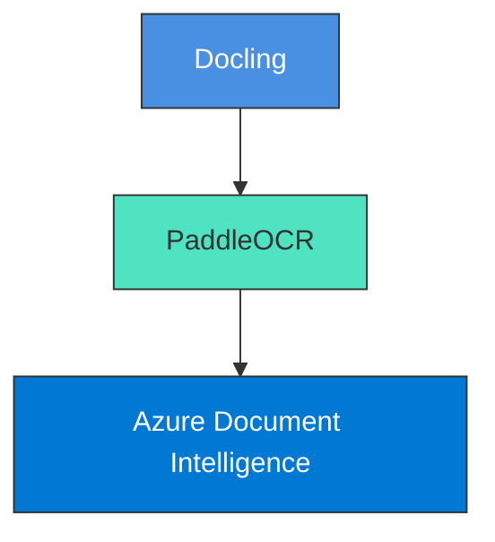
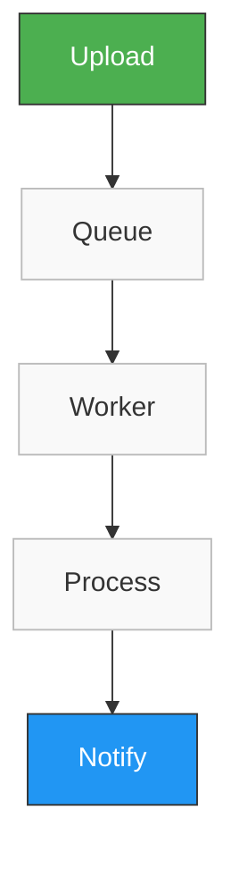

# OpenInvoiceAI

## System Architecture

Version: 1.0
Author: Sharath S Hebbar
Status: Draft

### Purpose

This document describes the high-level architecture of OpenInvoiceAI, including service integrations, agent orchestration, infrastructure components, data flow, and deployment architecure.

The goal is to build a modular, scalable, production-inspired AI platform for autonomous invoice processing using agentic workflows.

### High Level Architecture

```mermaid
graph TD
    %% Subgraph Layer 1: Presentation
    subgraph Layer_1 [1. User Interface]
        UI[Streamlit UI<br><small>Upload • Dashboard • Review</small>]
    end

    %% Subgraph Layer 2: API Gateway
    subgraph Layer_2 [2. API Gateway]
        API[FastAPI Gateway<br><small>REST APIs • Auth • Upload</small>]
    end

    %% Subgraph Layer 3: Queue Management
    subgraph Layer_3 [3. Message Broker & Queue]
        Redis[(Redis<br><small>Celery Queue</small>)]
    end

    %% Subgraph Layer 4: AI Workflow Engine
    subgraph Layer_4 [4. Background Worker & Orchestration]
        Worker[Celery Worker<br><small>Executes LangGraph Workflow</small>]
        Router[Supervisor Agent (Router)]
        
        %% Parallel Agents
        DocAgent[Document Agent]
        ValAgent[Validation Agent]
        PolAgent[Policy Agent]
        
        %% Downstream Processing
        DecAgent[Decision Agent]
        ERPAgent[ERP Agent]
        Human[Human Review]
        EvalAgent[Evaluation Agent]
    end

    %% Subgraph Layer 5: Storage
    subgraph Layer_5 [5. Persistence & Observability]
        DB[(PostgreSQL • Qdrant<br>Langfuse • Audit Logs)]
    end

    %% Direct Connections between layers
    UI --> API
    API -->|Create Processing Job| Redis
    Redis --> Worker
    Worker --> Router

    %% Router to Parallel Agents
    Router --> DocAgent
    Router --> ValAgent
    Router --> PolAgent

    %% Parallel Agents to Decision Agent
    DocAgent --> DecAgent
    ValAgent --> DecAgent
    PolAgent --> DecAgent

    %% Decision Agent Splits
    DecAgent --> ERPAgent
    DecAgent --> Human

    %% Final Chains
    ERPAgent --> EvalAgent
    EvalAgent --> DB

    %% Component Styling for GitHub Themes
    style UI fill:#FF4B4B,stroke:#333,stroke-width:1px,color:#fff
    style API fill:#009688,stroke:#333,stroke-width:1px,color:#fff
    style Redis fill:#DC382D,stroke:#333,stroke-width:1px,color:#fff
    style Worker fill:#376C29,stroke:#333,stroke-width:1px,color:#fff
    style DB fill:#336791,stroke:#333,stroke-width:1px,color:#fff
    style Router fill:#5A5A5A,stroke:#333,stroke-width:1px,color:#fff
    
    classDef default fill:#f4f5f6,stroke:#bbb,stroke-width:1px,color:#333;
```


### Design Principles

The architecture follows these principles

#### Modular

- Every component should be independently replaceable.
- Example 



- Changing OCR should not require changes elsewhere.

#### Agent Oriented

Every major business responsibility belongs to an independent AI Agent
Each Agent should:
- Have one responsibility
- Produce structured outputs
- Call tools when required
- Never directly access the UI

#### Event Driven

Invoice processing is asynchronous



- Users never wait for OCR.


#### Tool-Centric

Agents should reason.
Tools should execute.
Example:

Validation Agent decides -> Vendor Lookup Tool executes SQL

This separation keeps prompts simple and logic deterministic

#### Observable

Every Agent execution should produce:
- Logs
- Traces
- Metrics 
- LLM token usage
- Latency
- Tool Calls

### Component Responsibilities

#### 1. Application & Core Logic Components

| Component | Key Responsibilities | Architectural Constraints / Scope |
| :--- | :--- | :--- |
| **Streamlit** | • Upload invoices<br>• Show processing status<br>• Display reasoning<br>• Human approvals<br>• Dashboard<br>• History | ⚠️ **Never** performs AI processing. |
| **FastAPI** | • Receive uploads<br>• Validate requests<br>• Create Job<br>• Store files<br>• Expose REST APIs<br>• Return Job IDs | ⚠️ **Never** executes AI workflows. |
| **Redis** | • Queue jobs<br>• Message broker | *N/A* |
| **Celery** | • Execute background workflows<br>• Retry failed tasks<br>• Schedule long-running jobs | *N/A* |
| **LangGraph** | • Manage workflow state<br>• Execute agent graph<br>• Handle conditional routing<br>• Retry failed nodes<br>• Human interrupts | *N/A* |

#### 2. Databases & Storage Systems

| Database | Primary Storage Entities | Specialized Storage Engine Capability |
| :--- | :--- | :--- |
| **PostgreSQL** | • Invoices<br>• Jobs<br>• Policies<br>• Vendors<br>• Agent Runs<br>• Audit Logs<br>• Evaluations | Relational Data & System State Tracking |
| **Qdrant** | • Vendor history<br>• Previous invoices<br>• Company policy<br>• Invoice corrections | 🔍 Supports **semantic retrieval** using vector embeddings. |

#### 3. LLM Observability Layer

| Monitoring Platform | Telemetry & Metrics Captured |
| :--- | :--- |
| **Langfuse** | • Prompt traces<br>• Tool calls<br>• Token usage<br>• LLM latency<br>• Cost<br>• Agent reasoning |

### Agent Architecture

#### Supervisor Agent

Responsibilites
- Start Workflow
- Select next agent
- Handle failures 
- Retry Orchestration
- Maintain workflow state

Never performs business logic


# High Level Architecture

# Component Diagram

# Sequence Diagram

# Data Flow

# Technology Stack

# Service Responsibilities