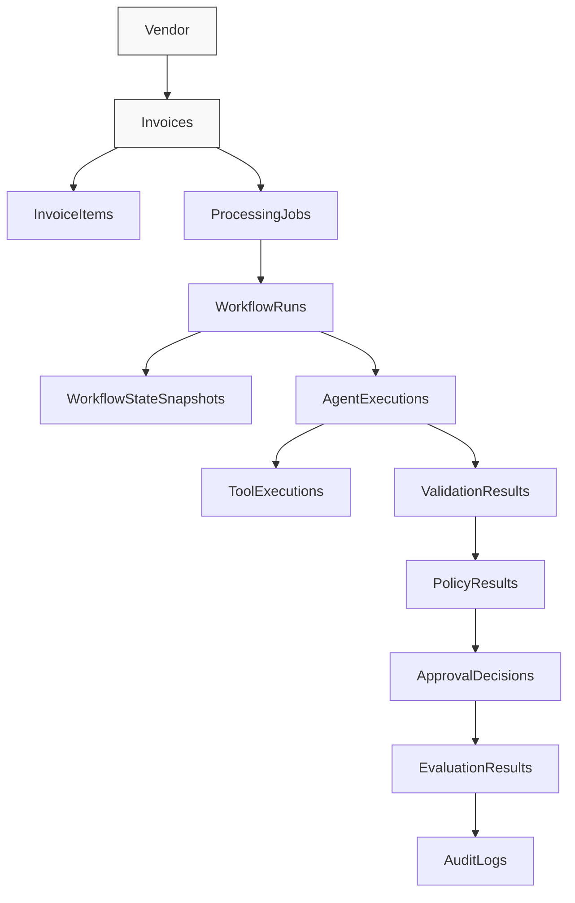
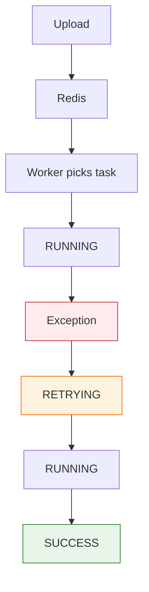
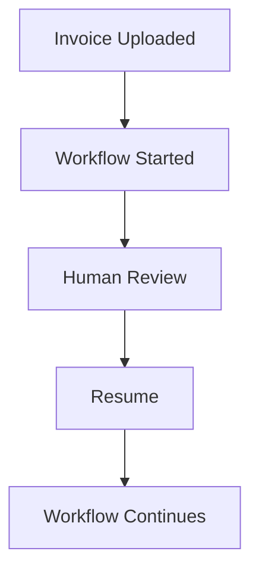
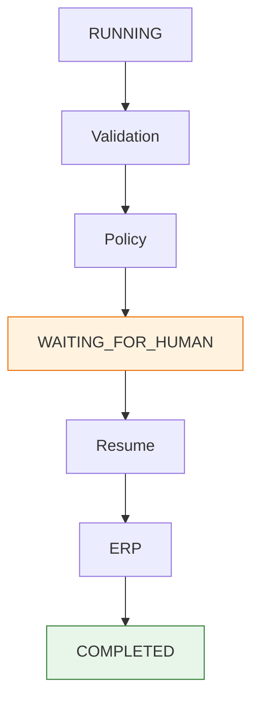
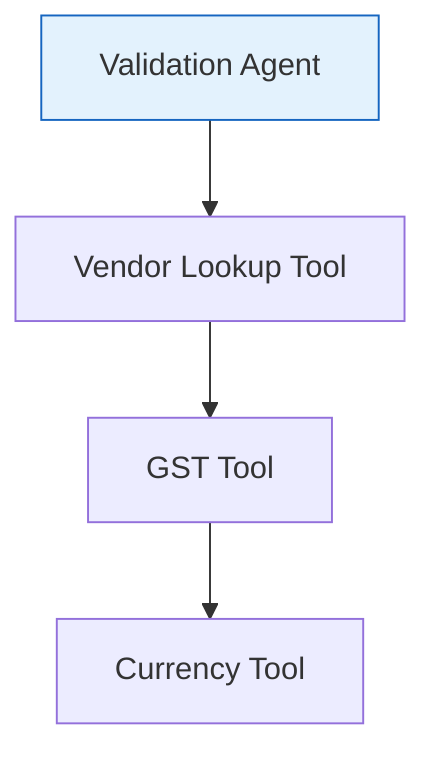
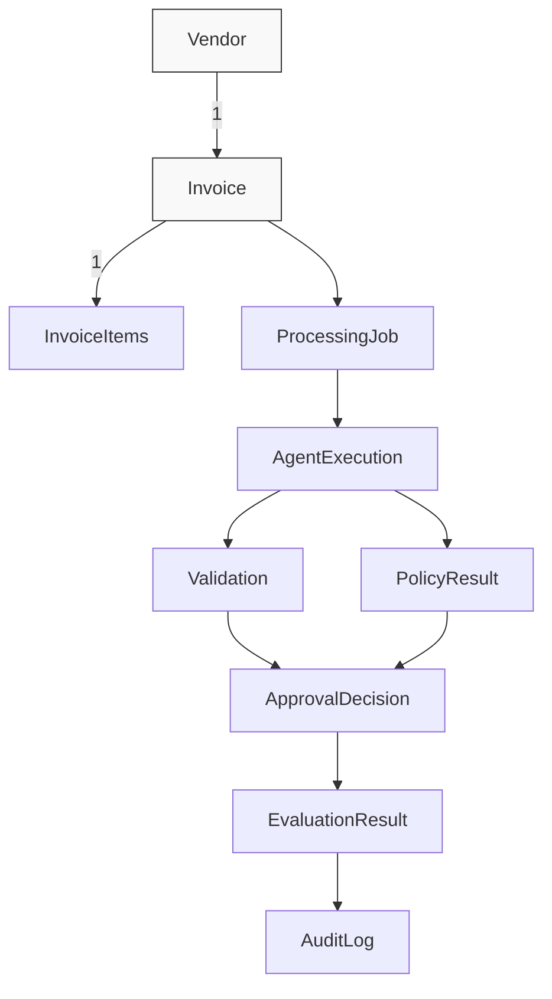

# OpenInvoiceAI

## Database Design

- Version: 1.0
- Author: Sharath S Hebbar
- Status: Draft

### Purpose

This document defines the relational database schema for OpenInvoiceAI.
The database is responsible for storing:
- Invoice metadata
- Processing jobs
- Agent Execution History
- Validation Results
- Human Review Decisions
- Vendor Master data
- Company Policies
- Audit Logs
- Evalutation Metrics

The database does not store embeddings. Embeddings are stored separately in Qdrant.

### Database Choice

| Component | Technology |
| --- | --- |
| Primary Database | PostgreSQL |
| ORM | SQLAlchemy 2.0 |
| Migration | Alembic |
| Vector Store | Qdrant |

### Design Principles

The schema follows the following principles:

#### Normalization
Avoid duplicated data while maintaining query performance

#### Auditability
Every important action must be traceable
Examples:
- Who Approved?
- Which agent rejected?
- Which policy was triggered?

#### Extensibility
New agents should be added without changing existing tables.

#### Event History
Never overwrite important processing events.
Always create history records

### High Level ER Diagram

### Tables

#### invoices

- Store one record per uploaded invoice

| Column         | Type        | Description           |
| -------------- | ----------- | --------------------- |
| id             | UUID        | Primary Key           |
| invoice_number | VARCHAR     | Vendor invoice number |
| vendor_id      | UUID        | FK Vendor             |
| file_name      | TEXT        | Uploaded filename     |
| storage_path   | TEXT        | File location         |
| currency       | VARCHAR(10) | Currency              |
| subtotal       | NUMERIC     | Before tax            |
| tax            | NUMERIC     | Tax                   |
| total          | NUMERIC     | Final amount          |
| invoice_date   | DATE        | Invoice date          |
| due_date       | DATE        | Payment due           |
| status         | VARCHAR     | Current status        |
| created_at     | TIMESTAMP   | Upload time           |
| updated_at     | TIMESTAMP   | Last update           |

Status Values

- Uploaded
- Processing
- Approved
- Rejected
- Failed
- Human Review

#### invoice_items

- Stores Invoice Line Items

| Column      | Type    |
| ----------- | ------- |
| id          | UUID    |
| invoice_id  | UUID    |
| description | TEXT    |
| quantity    | NUMERIC |
| unit_price  | NUMERIC |
| tax_rate    | NUMERIC |
| total       | NUMERIC |

- One Invoice -> Many items

#### vendors

- Master Vendor Table

| Column      | Type      |
| ----------- | --------- |
| id          | UUID      |
| vendor_name | TEXT      |
| gst_number  | TEXT      |
| email       | TEXT      |
| phone       | TEXT      |
| country     | TEXT      |
| currency    | TEXT      |
| risk_score  | FLOAT     |
| created_at  | TIMESTAMP |

##### Future Enhancement
- ERP Sync

#### processing_jobs

- For celery jobs only
- One row = one celery task

| Column         | Description        |
| -------------- | ------------------ |
| id             | UUID               |
| invoice_id     | FK                 |
| celery_task_id | Celery ID          |
| status         | QUEUED/RUNNING/... |
| retry_count    | Number of retries  |
| created_at     | Timestamp          |
| completed_at   | Timestamp          |

Status Values

| Status                 | Meaning                          |
| ---------------------- | -------------------------------- |
| QUEUED                 | Waiting in Redis                 |
| RUNNING                | Worker picked it up              |
| SUCCESS                | Celery task completed            |
| FAILED                 | Celery task crashed              |
| RETRYING               | Celery retry mechanism triggered |
| CANCELLED *(optional)* | User/system cancelled task       |

#### workflow_runs

- One processing job may create one or more workflow runs

Example

| Column            | Description           |
| ----------------- | --------------------- |
| id                | UUID                  |
| processing_job_id | FK                    |
| workflow_name     | invoice_processing_v1 |
| current_node      | ValidationAgent       |
| workflow_status   | RUNNING               |
| started_at        | Timestamp             |
| completed_at      | Timestamp             |

Status

| Status            | Meaning               |
| ----------------- | --------------------- |
| CREATED           | Workflow initialized  |
| IN_PROGRESS       | Executing nodes       |
| WAITING_FOR_HUMAN | Interrupted           |
| RESUMED           | Human approved        |
| COMPLETED         | Finished successfully |
| FAILED            | Workflow failed       |
| TERMINATED        | Manually stopped      |

#### workflow_state_snapshots

- Every transition stores `Invoice State`

| Column          | Description            |
| --------------- | ---------------------- |
| id              | UUID                   |
| workflow_run_id | FK                     |
| node_name       | Current LangGraph node |
| state_json      | JSONB                  |
| version         | INTEGER                |
| created_at      | Timestamp              |

#### agent_executions

- One row = One execution

| Column            | Type      |
| ----------------- | --------- |
| id                | UUID      |
| job_id            | UUID      |
| agent_name        | TEXT      |
| execution_order   | INTEGER   |
| input_state       | JSONB     |
| output_state      | JSONB     |
| confidence        | FLOAT     |
| latency_ms        | INTEGER   |
| llm_provider      | TEXT      |
| model_name        | TEXT      |
| prompt_tokens     | INTEGER   |
| completion_tokens | INTEGER   |
| total_tokens      | INTEGER   |
| status            | TEXT      |
| created_at        | TIMESTAMP |
| started_at        | TIMESTAMP |
| completed_at      | TIMESTAMP |
| error_message     | TEXT      |
| retry_number      | INTEGER   |
| trace_id          | UUID      |

Why ?

- Allow us to answer which agent failed?

#### tool_executions

- Every tool becomes observable

Columns

| Column             | Description  |
| ------------------ | ------------ |
| id                 | UUID         |
| agent_execution_id | FK           |
| tool_name          | VendorLookup |
| tool_input         | JSONB        |
| tool_output        | JSONB        |
| latency_ms         | INTEGER      |
| success            | BOOLEAN      |
| created_at         | Timestamp    |

#### validation_results

- Stores deterministic validation output

| Column            | Type      |
| ----------------- | --------- |
| id                | UUID      |
| invoice_id        | UUID      |
| gst_valid         | BOOLEAN   |
| po_valid          | BOOLEAN   |
| duplicate_invoice | BOOLEAN   |
| totals_match      | BOOLEAN   |
| currency_valid    | BOOLEAN   |
| validation_errors | JSONB     |
| created_at        | TIMESTAMP |

#### policy_results

- Stores policy reasoning

| Column            | Type      |
| ----------------- | --------- |
| id                | UUID      |
| invoice_id        | UUID      |
| policy_version    | TEXT      |
| approval_required | BOOLEAN   |
| risk_level        | TEXT      |
| reasoning         | TEXT      |
| triggered_rules   | JSONB     |
| created_at        | TIMESTAMP |

#### approval_decisions

- Human approval workflow

| Column      | Type      |
| ----------- | --------- |
| id          | UUID      |
| invoice_id  | UUID      |
| reviewer    | TEXT      |
| decision    | TEXT      |
| comments    | TEXT      |
| reviewed_at | TIMESTAMP |

Decision 
- Approved
- Rejected
- Request Changes

#### evaluation_results

- Stores AI quality metrics

| Column              | Type      |
| ------------------- | --------- |
| id                  | UUID      |
| invoice_id          | UUID      |
| extraction_score    | FLOAT     |
| validation_score    | FLOAT     |
| policy_score        | FLOAT     |
| hallucination_score | FLOAT     |
| confidence          | FLOAT     |
| latency_ms          | INTEGER   |
| cost                | FLOAT     |
| token_usage         | INTEGER   |
| prompt_version      | FLOAT     |
| model_version       | FLOAT     |
| overall_score       | FLOAT     |
| created_at          | TIMESTAMP |

#### audit_logs

- Immutable event history

| Column      | Type      |
| ----------- | --------- |
| id          | UUID      |
| entity_type | TEXT      |
| entity_id   | UUID      |
| event_type  | TEXT      |
| actor       | TEXT      |
| details     | JSONB     |
| timestamp   | TIMESTAMP |

Examples

- Invoice Uploaded
- Workflow started
- Agent Completed
- Tool Failed
- Human Approved
- ERP Synced

#### company_policies

- Stores configurable business rules

| Column           | Type      |
| ---------------- | --------- |
| id               | UUID      |
| policy_name      | TEXT      |
| description      | TEXT      |
| markdown_content | TEXT      |
| version          | TEXT      |
| active           | BOOLEAN   |
| created_at       | TIMESTAMP |

##### Future Enhancements
- RAG documents

#### prompts

- Stores prompt templates

| Column      | Type    |
| ----------- | ------- |
| id          | UUID    |
| prompt_name | TEXT    |
| version     | TEXT    |
| template    | TEXT    |
| active      | BOOLEAN |
| temperature | FLOAT   |
| max_tokens  | INTEGER |
| model_used  | TEXT    |
| created_by  | TEXT    |

### Relationships

### Indexes

- Invoices
    - invoice_number
    - vendor_id
    - status
    - invoice_date
    
- Processing Jobs
    - status
    - current_step

- Agent Executions
    - job_id
    - agent_name

- Audit Logs
    - entity_id
    - timestamp

### Data Retention

- Invoices
    - Retain indefinitely
- Audit Logs
    - Retain indefinitely
- Langfuse traces
    - 30-90 days (configurable)

### Future Enhancements

- Multi-tenant schema
- Row-level security
- Soft deletes
- Partitioned Audit Logs
- Event Sourcing
- CDC (Change Data Capture)
- PostgreSQL LISTEN / NOTIFY
- Time-series metrics table

#### Future Tables

- users
- roles
- permissions
- notifications
- attachments
- comments
- fraud_alerts
- cost_tracking
- llm_cache

### Why PostgreSQL ?

- Chosen because it provides:
    - ACID transactions
    - Strong relational modeling
    - JSONB support for semi-sructured AI Outputs
    - Mature ecosystem
    - Excellent SQLAlchemy support
    - Easy Docker deployment

### Workflow

Database

├── Core Domain
│   ├── invoices
│   ├── invoice_items
│   ├── vendors
│
├── Workflow
│   ├── processing_jobs
│   ├── workflow_runs
│   ├── workflow_state_snapshots
│
├── Agent Runtime
│   ├── agent_executions
│   ├── tool_executions
│
├── Business Logic
│   ├── validation_results
│   ├── policy_results
│   ├── approval_decisions
│
├── Observability
│   ├── evaluation_results
│   ├── audit_logs
│
└── Configuration
    ├── company_policies
    ├── prompts