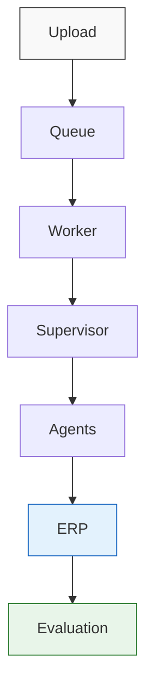
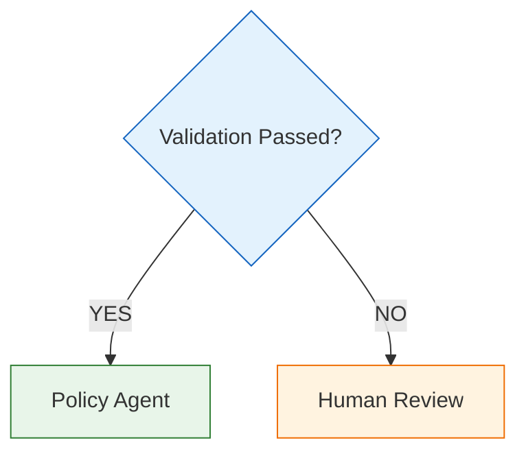
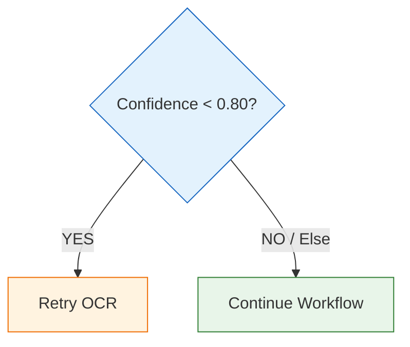
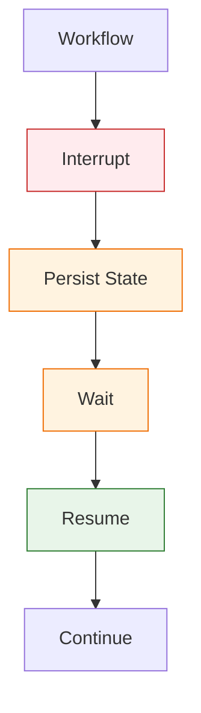
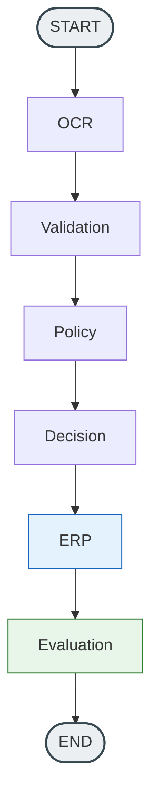
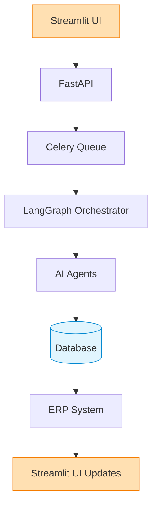

# OpenInvoice AI
## Workflow Design

- Version 1.0
- Author: Sharath S Hebbar
- Status: Draft

### Purpose

- Explain why Langgraph was chosen instead of sequential pipeline.

### Workflow Overview

- High Level Execution Flow

### Workflow State

- Define `InvoiceState`
    - InvoiceState
        - invoice
        - ocr_result
        - structured_invoice
        - validation
        - policy
        - decision
        - erp_status
        - evaluation
        - current_node
        - errors
        - retry_count

### Supervisor

Responsibilities
- Routing
- Retry
- Interrupt
- Resume
- Logging
- State transitions

Importantly

- The supervisor is deterministic, not LLM Driven

### Workflow Nodes

For each node:
- Purpose
- Input
- Output
- Failure Modes
- Next Nodes

Example
- Document Agent
    - Input: PDF
    - Output: Structured JSON
    - Possible Transitions
        - Success -> Validation Agent
        - Failure -> Retry -> Human Review

### Conditional Routing

Example 1

Example 2

### Human Review Interrupt

### Retry Strategy

Different Retry Strategies Examples

| Strategy | Retry Logic |
| -------- | ----------- |
| OCR      | Retry Twice |
| LLM Timeout | Exponential Backoff |
| ERP Failure | Queue Retry |
| Policy Failure | Human Review |

### Error Handling

- Recoverable vs Non-recoverable

Examples

- LLM Resilience
- Validation Failure
- OCR Timeout Handler

```mermaid
flowchart TD
    %% Scenario 1: OCR Timeout
    subgraph Scenario1 [OCR Timeout Handler]
        OCRTimeout[OCR Timeout] --> Retry[Retry Process]
    end

    %% Scenario 2: Invalid Invoice
    subgraph Scenario2 [Validation Failure]
        InvalidInvoice[Invalid Invoice] --> Reject[Reject Invoice]
    end

    %% Scenario 3: AI Availability
    subgraph Scenario3 [LLM Resilience]
        LLMUnavailable[LLM Unavailable] --> FallbackModel[Switch to Fallback Model]
    end

    %% Error/Exception Handling Styles
    style OCRTimeout fill:#ffebee,stroke:#c62828,stroke-width:1px
    style InvalidInvoice fill:#ffebee,stroke:#c62828,stroke-width:1px
    style LLMUnavailable fill:#ffebee,stroke:#c62828,stroke-width:1px
    
    %% Remediation Styles
    style Retry fill:#fff3e0,stroke:#ef6c00,stroke-width:1px
    style Reject fill:#ffcdd2,stroke:#b71c1c,stroke-width:2px
    style FallbackModel fill:#e8f5e9,stroke:#2e7d32,stroke-width:1px
```

### Workflow State Machine

### Sequence Diagram

### Design Decisions

