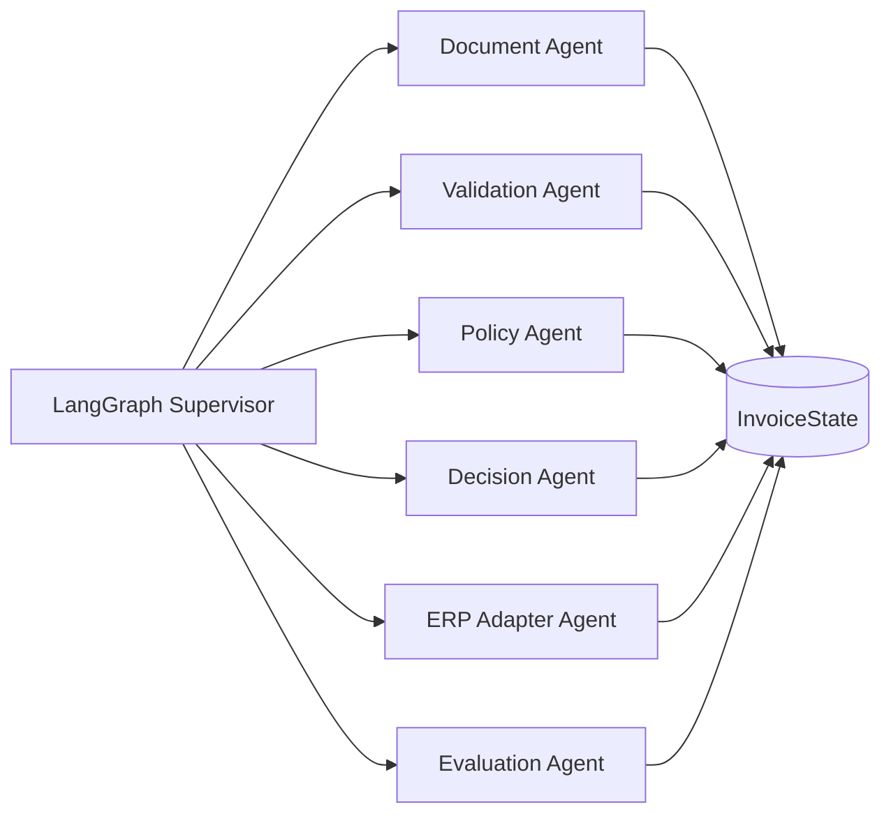
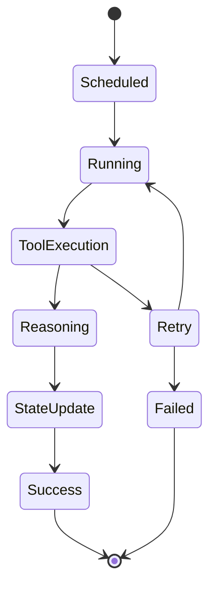
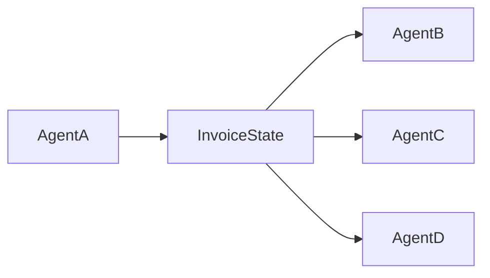
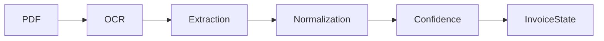
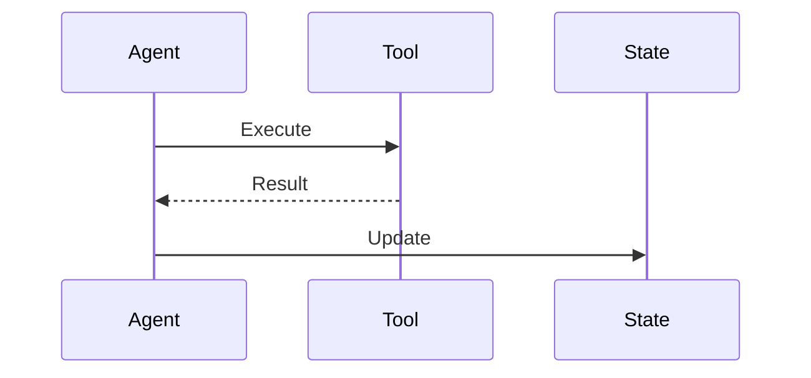

# OpenInvoiceAI

## Agent Design

- Version: 1.0
- Author: Sharath S Hebbar
- Status: Draft

### Purpose

- This document defines the architecture and operational behaviour of the intelligent agents within the OpenInvoice-AI platform
- Rather than embedding business logic into a single workflow, responsibilities are decomposed into specialized agents. Each agent owns a single business capability, operates independently, and communicates exclusively through the shared InvoiceState
- The document specifies:
    - Agent Responsibilities
    - Inputs and Outputs
    - State Ownership
    - Tool Usage
    - Interaction Model
    - Failure Handling
    - Retry Strategy
    - Prompt Architecture
    - Observability Requirements


### Design Principles

- The agent layer follows the following principles
| Principle              | Description                                                                  |
| ---------------------- | ---------------------------------------------------------------------------- |
| Single Responsibility  | Every agent performs one business capability only                            |
| Stateless Execution    | Agents never maintain local session state                                    |
| Shared State           | Communication occurs only through InvoiceState                               |
| Tool-Based             | Agents access external systems through tools rather than direct integrations |
| Deterministic Workflow | Workflow routing is handled exclusively by the Supervisor                    |
| Explainability         | Every decision must be traceable and auditable                               |
| Retry Safe             | Agents must be idempotent whenever possible                                  |
| Observable             | Every execution emits telemetry                                              |


### Agent Architecture



### Agent Lifecycle



### Agent Communication Model 

- Agents never communicate directly. Instead,



This provides
- loose coupling
- resumability
- auditability
- deterministic replay

### Shared Agent Contract

- Every Agent implements a common interface
```python
class BaseAgent:

    def run(
        self,
        state: InvoiceState
    ) -> InvoiceState:
        ...
```

Responsibilities include:
- Read only the required state
- Perform reasoning
- Invoke tools if necesary
- Update owned state
- Return the modified InvoiceState

Agents must not modify unrelated state sections


### Agent Overview

| Agent             | Responsibility                  | Uses LLM | Uses Tools |
| ----------------- | ------------------------------- | -------- | ---------- |
| Document Agent    | OCR extraction & normalization  | Yes      | Yes        |
| Validation Agent  | Validate extracted invoice      | Optional | Yes        |
| Policy Agent      | Apply business policies         | Yes      | Yes        |
| Decision Agent    | Approve / Reject / Human Review | Yes      | No         |
| ERP Adapter Agent | Push approved invoice           | No       | Yes        |
| Evaluation Agent  | Evaluate workflow quality       | Yes      | Yes        |

### Document Agent

Purpose
- Transforms an uploaded invoice into structured data
    
Responsibilities
- Load document
- OCR
- Detect Layout
- Extract entities
- Normalize values
- Confidence scoring

Inputs
- raw_document

Outputs
- structured_invoice
- confidence_scores
- ocr_metadata

State Ownership
- Updates
    - state.document

Tools
- Docling
- OCR Engine
- PDF Parser

Failure Models

| Failure            | Action       |
| ------------------ | ------------ |
| OCR failure        | Retry        |
| Corrupt PDF        | Reject       |
| Unsupported format | Reject       |
| Low confidence     | Human Review |

Workflow



### Validation Agent

Purpose
- Validate invoice consistency

Checks include
- Missing fields
- Duplicate Invoice
- Currency
- Tax
- Vendor Existence
- Mathematical Validation

Workflow

```mermaid 
flowchart LR

StructuredInvoice

↓

SchemaValidation

↓

BusinessValidation

↓

DuplicateCheck

↓

ValidationResult
```

Updates
- state.validation

### Policy Agent

Purpose
- Apply organization-specific rules.

Example rules
- Maximum invoice amount
- Vendor restrictions
- Department budgets
- PO Requirement
- Payment Terms


Workflow

```mermaid
flowchart LR

StructuredInvoice

↓

SchemaValidation

↓

BusinessValidation

↓

DuplicateCheck

↓

ValidationResult
```

Updates
- state.policy

### Decision Agent

Purpose
- Produce the final processing decision

Possible Outputs
- Approved
- Rejected
- Human_Review

Decision Inputs
- Validation
- Policy
- Confidence
- Business Rules

Decision Tree

```mermaid 
flowchart LR

StructuredInvoice

↓

SchemaValidation

↓

BusinessValidation

↓

DuplicateCheck

↓

ValidationResult
```

Updates
- state.decision

### ERP Adapter Agent

Purpose
- Synchronize approved invoices to downstream ERP Systems

Current Implementations
- Mock ERP

Future Implementation
- Zoho
- SAP
- Oracle
- Dynamics

Workflow

```mermaid
flowchart LR

ApprovedInvoice

↓

Transformation

↓

ERP API

↓

Response

↓

InvoiceState
```

Updates
- state.erp

### Evaluation Agent

Purpose
- Measure workflow quality

Metrics
- OCR Accuracy
- Hallucination detection
- Validation correctness
- Policy Correctness
- Latency
- Cost
- Token Usage

Outputs
- Evaluation Report

Workflow
```mermaid
flowchart LR

WorkflowState

↓

Metrics

↓

LLM Evaluation

↓

Quality Report
```

Updates
- state.evaluation

### State Ownership Matrix

| State      | Owner            |
| ---------- | ---------------- |
| document   | Document Agent   |
| validation | Validation Agent |
| policy     | Policy Agent     |
| decision   | Decision Agent   |
| erp        | ERP Adapter      |
| evaluation | Evaluation Agent |

No other agent may mutate these sections.

### Tool Invocation Strategy



- Agents never call external services directly
- All integrations occur through tools

### Prompt Architecture
- Every LLM powered agent follows a standardized prompt structure

```mermaid
System Prompt

↓

Business Context

↓

Task Instructions

↓

InvoiceState Context

↓

Tool Results

↓

Expected Output Schema
```

This ensures:
- Consistency
- Structured Outputs
- Deterministic Behaviour
- Reduced Hallucinations

### Error Handling Strategy

```mermaid
flowchart TD

Agent

↓

Success?

No --> Retry

Retry --> Success

Retry --> Failed

Failed --> Human Review

Success --> Continue
```

### Observability

Each agent emits telemetry including:
- Execution ID
- Workflow ID
- Agent Name
- Start Time
- End Time
- Latency
- Token Usage
- Model Used
- Tool invocations
- Prompt Version
- Retry Count
- Final Status

### Future Enhancements

The architecture is intentionally extensible. Potential future agents include:

| Agent                     | Purpose                                               |
| ------------------------- | ----------------------------------------------------- |
| Vendor Intelligence Agent | Vendor reputation and risk scoring                    |
| Fraud Detection Agent     | Detect anomalous or suspicious invoices               |
| Cost Optimization Agent   | Optimize LLM routing based on complexity              |
| Memory Agent              | Persist long-term workflow knowledge                  |
| Notification Agent        | Send approval and failure notifications               |
| Analytics Agent           | Generate operational dashboards and business insights |


