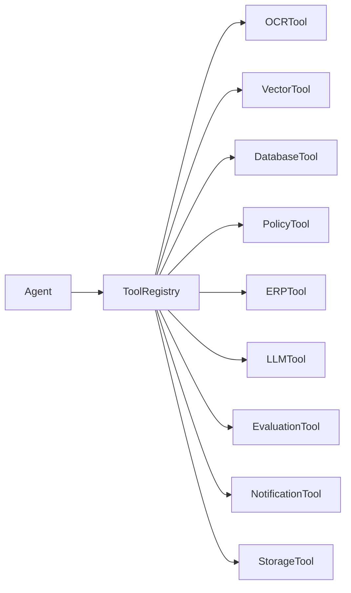
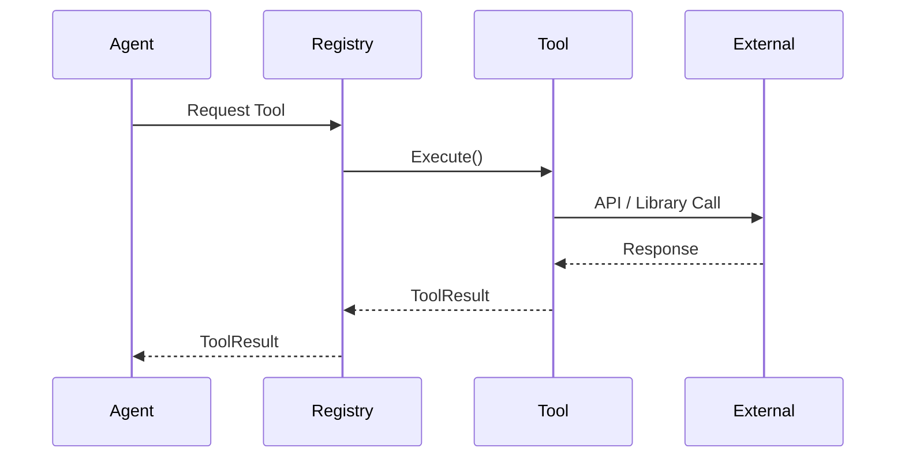
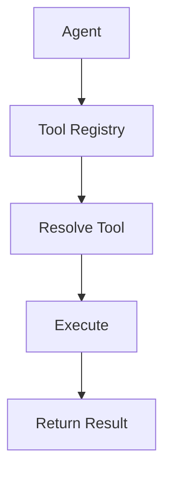
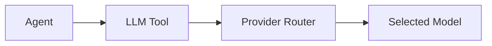
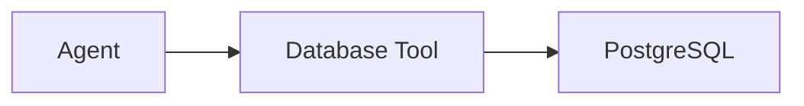
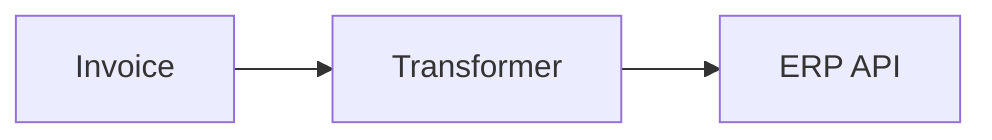
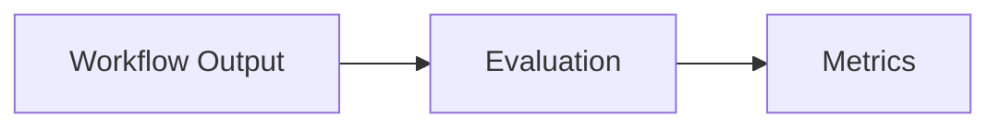
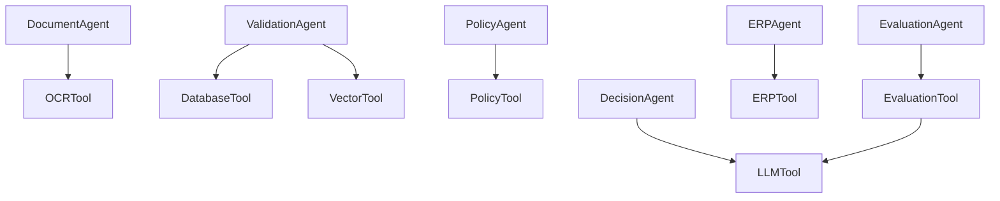
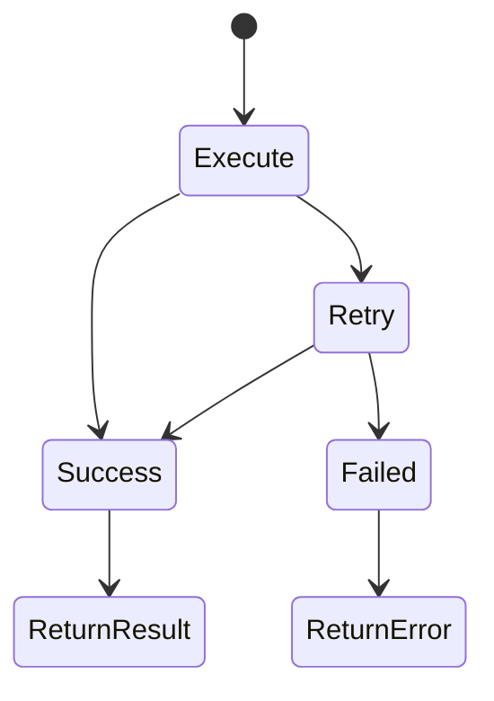
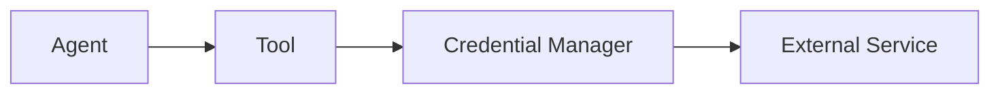

# OpenInvoiceAI

## Tool Design

- Version: 1.0
- Author: Sharath S Hebbar
- Status: Draft

### Purpose

- This document defines the design and architecture of the Tool Layer within the OpenInvoice AI Platform
- The Tool Layer encapsulated all interactions with external systems, services, databases, and libraries. Rather than allowing agents to communicate directly with external resources, every interaction is routed through a standardized tool interface.
- This approach provides:
    - Separation of Concerns
    - Consistent observability
    - Retry Handling
    - Security boundaries
    - Dependency Isolation
    - Easier testing and mocking

### Design Goals

| Goal          | Description                                                |
| ------------- | ---------------------------------------------------------- |
| Reusable      | Tools should be reusable across multiple agents            |
| Stateless     | Tools should not maintain execution state                  |
| Observable    | Every invocation emits telemetry                           |
| Replaceable   | Underlying implementation can be swapped                   |
| Deterministic | Same input should produce the same output where applicable |
| Secure        | Credentials remain isolated from agents                    |


### High Level Tool Architecture



- The Tool Registry acts as the central dispatcher responsible for resolving and invoking tools.

### Tool Execution Flow



### Tool Categories

| Category         | Purpose                      |
| ---------------- | ---------------------------- |
| Document Tools   | OCR, PDF parsing             |
| LLM Tools        | Model inference              |
| Retrieval Tools  | Vector search                |
| Database Tools   | CRUD operations              |
| Business Tools   | Policy lookup                |
| ERP Tools        | Invoice synchronization      |
| Storage Tools    | File management              |
| Evaluation Tools | Workflow evaluation          |
| Utility Tools    | Logging, parsing, formatting |


### Base Tool Contract

- All tools implement a common interface

```python
class BaseTool:

    name: str

    description: str

    async def execute(
        self,
        **kwargs
    ) -> ToolResult:
        ...
```

- Every tool returns a standardized `ToolResult`

### Tool Result Schema

Schema

- status
- payload
- metadata
- latency
- error
- warnings
- timestamp

Every invocation produces:

- Execution status
- Result Payload
- Metadata
- Latency
- Error Information
- Warning Messages
- Timestamp

### Tool Registry

The Tool Registry is responsible for:

- Tool Discovery
- Dependency Injection
- Configuration Loading
- Authentication
- Telemetry
- Version Management

Flow



### Document Tools

Responsibilities

- Parse PDF
- OCR Extraction
- Layout Detection
- Table Extraction
- Image Preprocessing


Future Alternatives:
- PaddleOCR
- Surya OCR
- Tesseract

### LLM Tool

Purpose:
- Provide a unified for multiple LLM Providers

Supported Providers:
- Ollama
- LiteLLM
- llama.cpp
- vLLM

Supported Models
- Qwen
- Llama
- Gemma
- Mistral

Flow



### Vector Search Tool

Responsibilites:
- Embedding Generation
- Similarity Search
- Context Retrieval

Flow


Future Support
- FAISS
- Milvus
- PGVector


### Database Tool

Responsibilities:

- Persist workflow state
- Read configuration
- Store agent outputs
- Record audit events

Flow



### Policy Tool

Responsibilities
- Load Policy Definitions
- Execute rule engine
- Return policy voilations

Flow


Future Enhancement:
- Support Dynamic Policy Loading

### ERP Tool

Responsibilities:
- Transform Invoice
- Call ERP APIs
- Handle Retries
- Record Synchronization Status

Supported Targets:
- Mock ERPs
- Zoho Books
- SAP
- Oracle
- Microsoft Dynamics

Flow



### Storage Tool

Responsibilities
- Upload files
- Download Invoices
- Archive processed documents
- Generate signed URLs

Support storage
- Local Filesystem
- Azure Blob
- AWS S3
- MinIO

### Evaluation Tool

Responsibilities
- Deep Eval
- RAGAS
- Promptfoo
- Hallucination Detection
- Cost Evaluation

Flow



### Notification Tool

Responsibilities
- Email Notification
- Slack Notification
- Teams Notification
- Human Review Alerts

Future Integrations
- Microsoft Teams
- Discord
- Webhooks

### Tool Dependency Diagram

Flow



### Error Handling Strategy

Flow



Retry policy should use:
- Exponential backoff
- Configurable retry limits
- Circuit breaker for persistent failures


### Observability

Each tool invocation records:

| Metric      | Description         |
| ----------- | ------------------- |
| Tool ID     | Unique identifier   |
| Tool Name   | Executed tool       |
| Agent Name  | Calling agent       |
| Workflow ID | Associated workflow |
| Latency     | Execution time      |
| Retry Count | Number of retries   |
| Status      | Success / Failure   |
| Error Code  | Failure reason      |
| Input Size  | Payload size        |
| Output Size | Response size       |


### Security Model

Flow



Security Priniciples:
- Agents never access secrets directly.
- Tools retrieve credentials from a secure configuration layer.
- API Keys are rotated independently.
- All external communication uses TLS.

### Future Enhancements

Potential Future Tools:

| Tool                     | Purpose                        |
| ------------------------ | ------------------------------ |
| Fraud Detection Tool     | Detect suspicious invoices     |
| Currency Conversion Tool | Exchange rate lookup           |
| Tax Validation Tool      | Validate GST/VAT calculations  |
| Vendor Reputation Tool   | Risk scoring                   |
| Translation Tool         | Multi-language invoice support |
| Calendar Tool            | Payment scheduling             |
| Analytics Tool           | Business intelligence metrics  |


