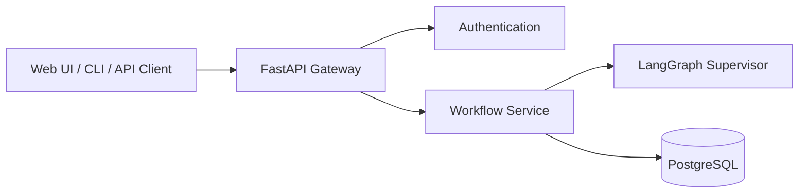
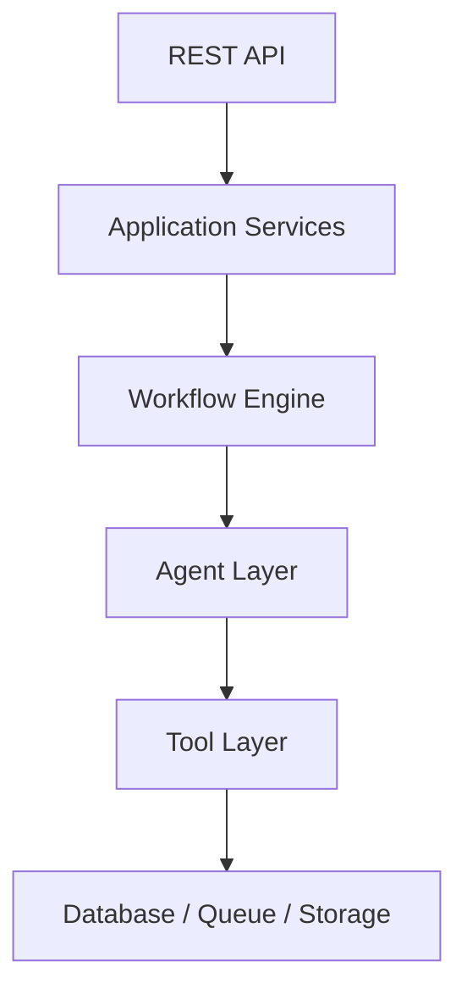
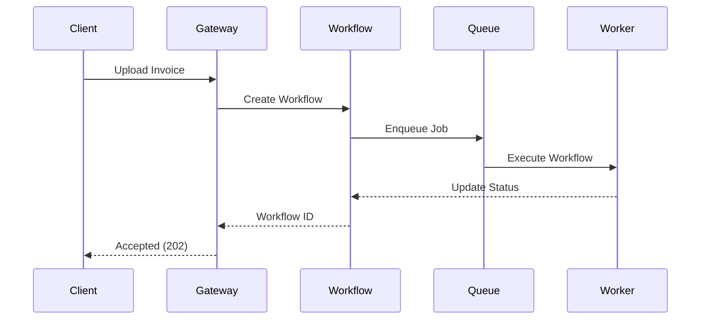
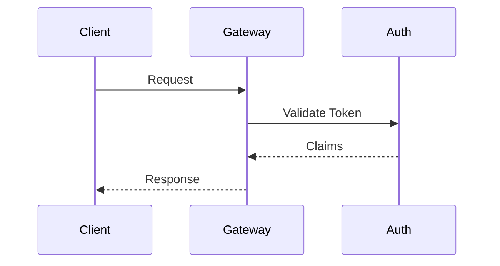
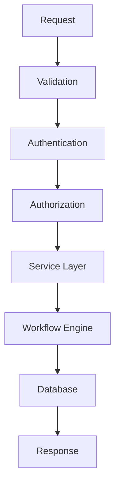
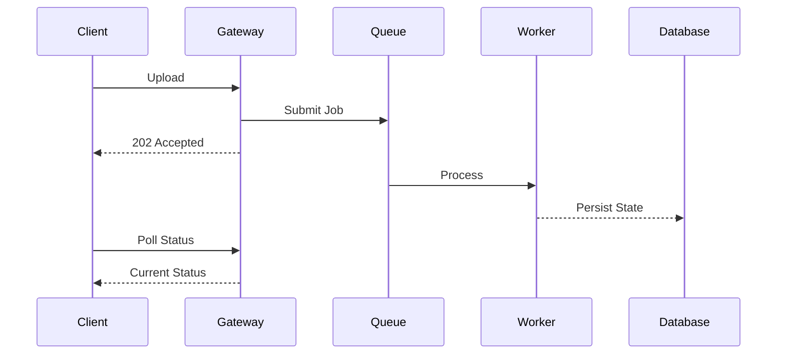

# OpenInvoiceAI

## API Design

- Version: 1.0
- Author: Sharath S Hebbar
- Status: Draft

### Purpose

- This document defines the external and internal APIs exposed by the OpenInvoice AI Platform.
- The API Layer provides a stable interface for clients while abstracting workflow orchestration, agent execution, persistence, and external integrations.
- The API is designed around asynchronous, workflow-driven processing rather than traditional request-response interactions.

### Design Goals

| Goal        | Description                                    |
| ----------- | ---------------------------------------------- |
| RESTful     | Predictable resource-oriented endpoints        |
| Async-first | Long-running operations execute asynchronously |
| Versioned   | Backward-compatible API evolution              |
| Stateless   | Each request is self-contained                 |
| Observable  | Every request is traceable                     |
| Secure      | Authentication and authorization enforced      |
| Idempotent  | Safe retries for client requests               |


### High Level API Architecture



### API Architecture Layers



### Resource Model

Primary resources exposed by the API:

| Resource        | Description                 |
| --------------- | --------------------------- |
| Invoice         | Uploaded invoice document   |
| Workflow        | Workflow execution instance |
| Agent Execution | Individual agent run        |
| Job             | Background processing task  |
| Evaluation      | Workflow evaluation report  |
| Configuration   | Runtime settings            |
| Health          | System health information   |


### API Flow



### Authentication

Supported Mechanisms:
- JWT
- API Keys
- OAuth2 (future)

Flow



### API Versioning

`/api/v1/`

Future Versions

`/api/v2/`
`/api/v3/`

Breaking changes require a new API Version

### Invoice Endpoints

#### Upload Invoice

`POST /api/v1/invoices/`

Purpose
- Upload Invoice
- Create Workflow
- Return workflow identifier

Response

```json
{
  "workflow_id": "...",
  "invoice_id": "...",
  "status": "QUEUED"
}
```

#### Get Invoice

`GET /api/v1/invoices/{invoice_id}`

Returns:
- Metadata
- Processing status
- Current Workfllow state

#### List Invoices

`GET /api/v1/invoices`

Supports:
- Pagination
- Sorting
- Filtering

### Workflow Endpoints

#### Get Workflow

`GET /api/v1/workflows/{workflow_id}`

Returns 
- Current Node
- Status
- Retry Count
- Checkpoints
- Timeline

#### Resume Workflow

`POST /api/v1/workflows/{workflow_id}/resume`

#### Retry Workflow

`POST /api/v1/workflows/{workflow_id}/retry`

#### Cancel Workflow

`POST /api/v1/workflows/{workflow_id}/cancel`

### Agent Endpoints

`GET /api/v1/agents`

Returns registered agents.

`GET /api/v1/agents/{agent_name}`

Returns
- Version
- Configuration
- Capabilities
- Supported Tools

### Evaluation Endpoints

`GET /api/v1/evaluations/{workflow_id}`

Returns:
- Quality Metrics
- Hallucination Score
- Cost
- Latency
- Overall evaluation

### Health Endpoints

`GET /health`

Returns service status

`GET /ready`

Readiness probe

`GET /live`

Liveness probe

### Configuration Endpoints

`GET /api/v1/config`

`PATCH /api/v1/config`

Configuration examples:
- Active LLM
- OCR backend
- Retry Limits
- Confidence Thresholds

### Request Lifecycle



### Error Handling

Standardized error schema:

```json
{
  "error": {
    "code": "VALIDATION_ERROR",
    "message": "Invoice amount missing",
    "details": [],
    "request_id": "..."
  }
}
```

HTTP Status Codes:

| Code | Meaning          |
| ---- | ---------------- |
| 200  | Success          |
| 201  | Created          |
| 202  | Accepted         |
| 400  | Bad Request      |
| 401  | Unauthorized     |
| 403  | Forbidden        |
| 404  | Not Found        |
| 409  | Conflict         |
| 422  | Validation Error |
| 429  | Rate Limited     |
| 500  | Internal Error   |


### Async Processing



#### Future Enhancement

- Server-Sent Events (SSE)
- WebSockets
- Webhooks

### API Rate Limiting

Policies:
- Upload requests
- Workflow operations
- Configuration changes

Example:

```100 requests/minute```

Implemented a Gateway Layer.

### Observability

Each request records:
- Request ID
- Trace ID
- User ID
- Workflow ID
- Latency
- Status Code
- Endpoint
- Payload size
- Processing Time

### Security Considerations

- HTTPS only
- JWT validation
- API Key support
- Input validation
- File type validation
- File size limits
- Rate Limiting
- Audit Logging

### OpenAPI Specification

FastAPI automatically generates:

- Swagger UI (`/docs`)
- ReDoc (`/redoc`)
- OpenAPI JSON (`/openapi.json`)

These specificatiobs serve as the contract between frontend and backend.

### Future Enhancements

Potential future APIs:

| API              | Purpose                    |
| ---------------- | -------------------------- |
| Batch Upload API | Process multiple invoices  |
| Webhook API      | Push workflow events       |
| WebSocket API    | Real-time workflow updates |
| GraphQL API      | Flexible querying          |
| Admin API        | Operational management     |
| Metrics API      | Dashboard integration      |

### Architecture Decision Records (ADR)

| ADR ID  | Decision                        | Rationale                                      |
| ------- | ------------------------------- | ---------------------------------------------- |
| ADR-015 | REST-first API design           | Simplicity and broad compatibility             |
| ADR-016 | Asynchronous workflow execution | Long-running AI tasks should not block clients |
| ADR-017 | Versioned endpoints             | Safe evolution of public interfaces            |
| ADR-018 | Standardized error schema       | Consistent client experience                   |
| ADR-019 | OpenAPI as the source of truth  | Automatic documentation and SDK generation     |


