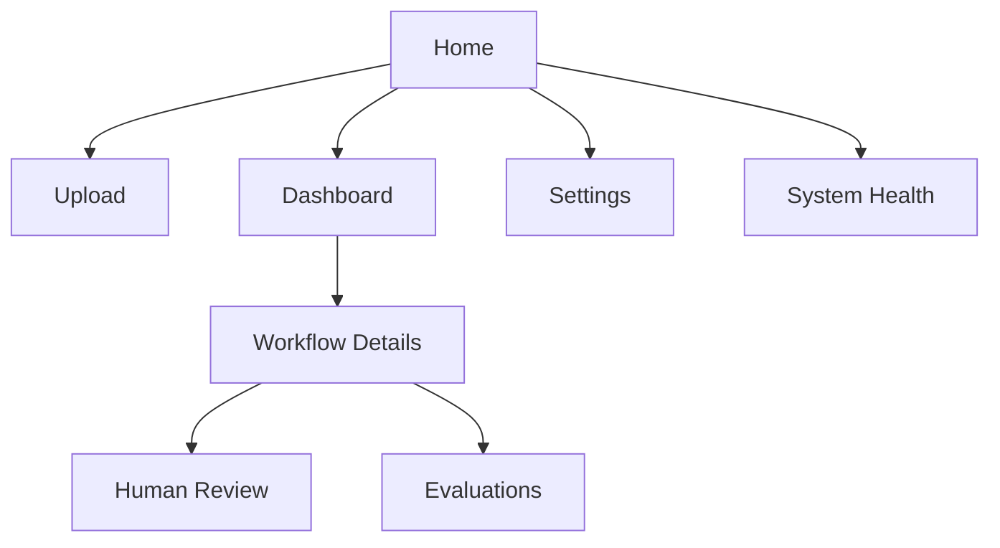
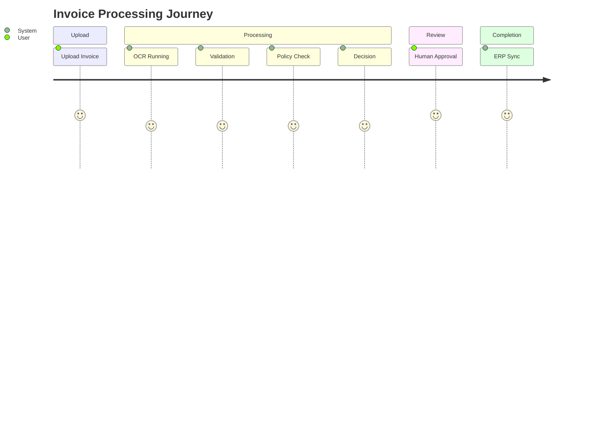
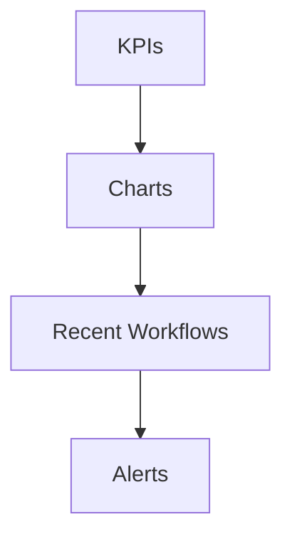
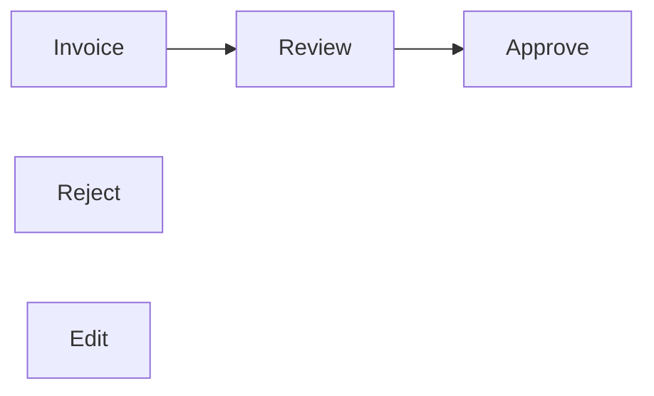
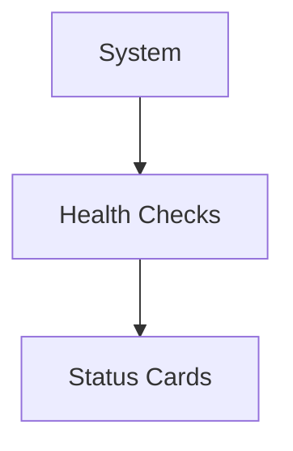
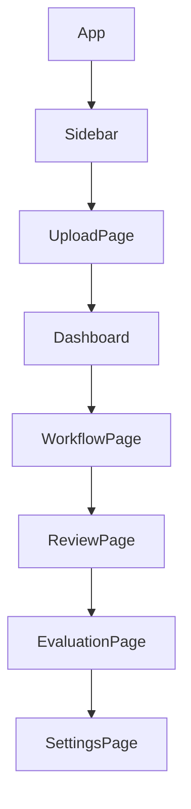
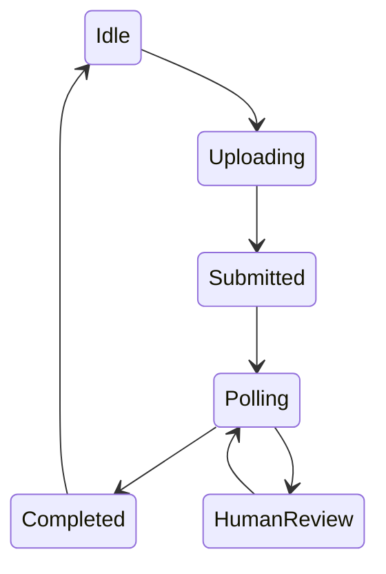
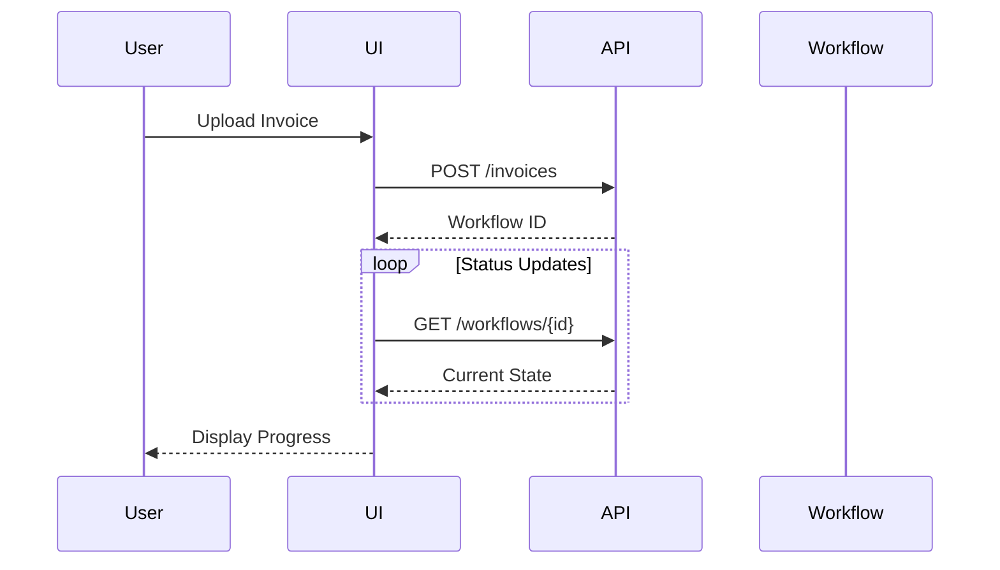

# OpenInvoiceAI

## UI/UX Design

- Version: 1.0
- Author: Sharath S Hebbar
- Status: Draft

### Purpose

- This document defines the user interface architecture, user experience flows, and frontend components for the OpenInvoice-AI platform
- The Frontend provides a single operational interface for uploading invoices, monitoring workflows, reviewing agent decisions, resolving exceptions, and analyzing system performance.
- The design emphasizes transparency, observability, and efficient human-in-the-loop interactions rather than simply serving as an upload page

### Design Goals

| Goal         | Description                                 |
| ------------ | ------------------------------------------- |
| Simplicity   | Minimal learning curve                      |
| Transparency | Expose workflow progress clearly            |
| Human Review | Easy approval and correction workflows      |
| Real-Time    | Live status updates                         |
| Responsive   | Desktop-first with responsive layouts       |
| Extensible   | Modular component architecture              |
| Accessible   | WCAG-compliant interactions where practical |

### Technology Stack

| Component        | Technology                   |
| ---------------- | ---------------------------- |
| Framework        | Streamlit (MVP)              |
| Future Upgrade   | React + FastAPI              |
| State Management | Streamlit Session State      |
| Charts           | Plotly                       |
| Tables           | AgGrid / Streamlit DataFrame |
| File Upload      | Streamlit File Uploader      |
| Authentication   | JWT (future)                 |

### Frontend Architecture

### Application Navigation

### User Journey

### Screen Overview

| Screen          | Purpose                 |
| --------------- | ----------------------- |
| Home            | Entry point             |
| Upload          | Upload invoices         |
| Dashboard       | Monitor processing      |
| Workflow Detail | View workflow state     |
| Human Review    | Resolve exceptions      |
| Evaluation      | Inspect quality metrics |
| Settings        | Runtime configuration   |
| Health          | System diagnostics      |

### Upload Screen

Purpose:
- Upload one or more invoices
- Display upload progress
- Validate file type
- Submit workflow

Displayed Information:
- File name
- size
- Upload status
- Workflow ID

### Dashboard

The dashboard provides a high level operational overview

Widgets:
- Total Invoices
- Processing Queue
- Completed workflows
- Failed workflows
- Human review queue
- Average Latency
- Token Usage
- Daily throughput

### Workflow Details Screen

Purpose:

Display the full execution history of a workflow

Information includes:
- Current State
- Active Agent
- Workflow Timeline
- State transitions
- Agent Outputs
- Tool invoications
- Errors
- Retry history

### Human Review Screen

This is one of the most important screens

Users can:
- Review extracted invoice fields
- Compare OCR output with the original document
- Edit incorrect values
- Approve
- Reject 
- Resume Workflow

### Evaluation Dashboard

Displays workflow quality metrics

Metrics include:

- OCR confidence
- Validation success rate
- Policy violations
- LLM Latency
- Token usage
- Cost estimation
- Hallucination score

Charts:
- Processing Latency
- Agent execution time
- Daily throughput
- Cost trends

### Settings Screen

Allows administrators to configure
- Active LLM
- OCR Engine
- Confidence thresholds
- Retry limits
- Human review threshold
- Feature flags

### System Health Screen

Displays:
- Database status
- Redis Status
- LLM Availability
- Queue depth
- API Health
- Storage connectivity

### Component Hierarchy

### Frontend State Management

### API Interaction

#### Future Enhancement
- Websockets
- SSE (Server-Sent Events)
- Push notifications

### Error Handling

Common Scenarios

| Error                  | UI Behavior        |
| ---------------------- | ------------------ |
| Upload failed          | Retry prompt       |
| Invalid file           | Validation message |
| Workflow failed        | Error banner       |
| API unavailable        | Offline indicator  |
| Authentication expired | Redirect to login  |

### Accessibility

Key considerations
- Keyboard navigation
- Screen reader labels
- High-contrast mode (future)
- Responsive layouts
- Clear error messaging

### Performance considerations

- Lazy load workflow history
- Paginate invoice lists
- Cache dashboard data
- Poll only active workflows
- Compress uploaded files when appropriate

### Future Enhancements
Potential additions

| Feature              | Purpose                   |
| -------------------- | ------------------------- |
| Drag-and-drop upload | Improved UX               |
| Dark mode            | User preference           |
| Batch upload         | Process multiple invoices |
| Workflow replay      | Debugging                 |
| Live notifications   | Real-time updates         |
| Mobile support       | Operational monitoring    |

### Architecutre Decision Records (ADR)

| ADR ID  | Decision                              | Rationale                               |
| ------- | ------------------------------------- | --------------------------------------- |
| ADR-020 | Streamlit for MVP                     | Faster development and lower complexity |
| ADR-021 | Dashboard-centric UX                  | Focus on operational visibility         |
| ADR-022 | Polling for workflow updates          | Simpler initial implementation          |
| ADR-023 | Human review as a first-class feature | Essential for AI-assisted workflows     |
| ADR-024 | React reserved for future scalability | Avoid premature complexity              |
