# OpenInvoiceAI

## Deployment Architecture

- Version: 1.0
- Author: Sharath S Hebbar
- Status: Draft

### Purpose

- This document defines the deployment architecture for the OpenInvoice-AI Platform, including infrastructure topology, containerization, networking, scaling, strategy, storage, and runtime dependencies.
- The architecture supports
    - Local Development
    - Single Node Deployment
    - Cloud Deployment
    - Future K8s based scaling

### Development Goals

| Goal           | Description                             |
| -------------- | --------------------------------------- |
| Portable       | Run locally or in the cloud             |
| Containerized  | All services run in Docker containers   |
| Scalable       | Independent service scaling             |
| Fault Tolerant | Recover from service failures           |
| Observable     | Centralized monitoring and logging      |
| Secure         | Network isolation and secret management |

### Deployment Topology

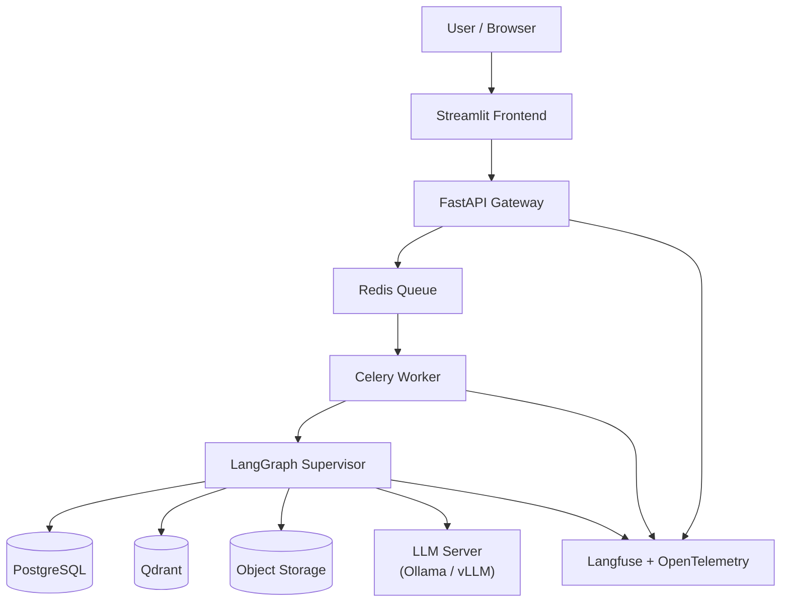

### Runtime Components

| Component   | Responsibility         |
| ----------- | ---------------------- |
| Streamlit   | User interface         |
| FastAPI     | REST API               |
| Redis       | Message broker         |
| Celery      | Background jobs        |
| LangGraph   | Workflow orchestration |
| PostgreSQL  | Persistent data        |
| Qdrant      | Vector search          |
| Ollama/vLLM | LLM inference          |
| Langfuse    | LLM observability      |

### Container Architecture

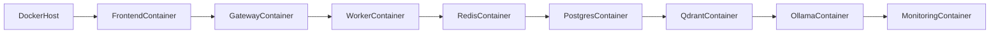

Each service runs independently and communicates over Docker networks

### Docker Network

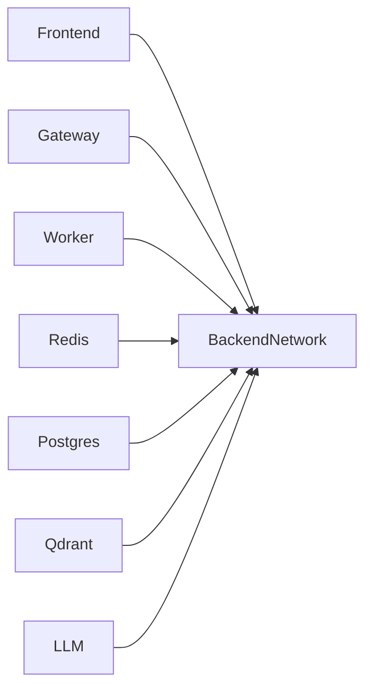

A dedicated backend network isolates internal services from external access.

### Request Flow

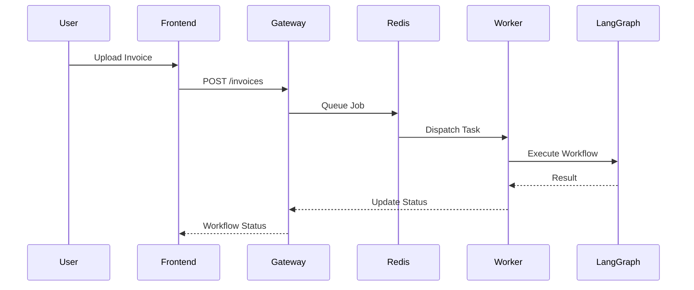

### Storage Architecture

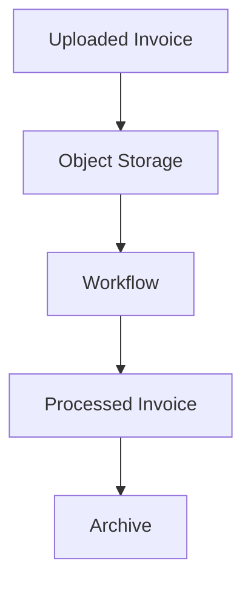

Supported storage backends
- Local filesystem (development)
- MinIO
- AWS S3
- Azure Blob Storage

### LLM Deployment

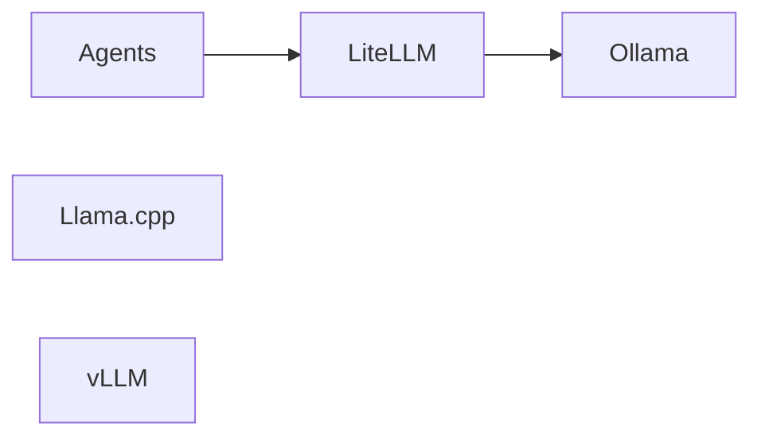

The abstraction layer allows switching between providers without changing agent logic.

### Scaling Strategy

| Component      | Scaling Method                 |
| -------------- | ------------------------------ |
| Streamlit      | Horizontal replicas            |
| FastAPI        | Multiple instances             |
| Celery Workers | Worker pool expansion          |
| Redis          | Single instance (MVP)          |
| PostgreSQL     | Vertical scaling / replication |
| Qdrant         | Cluster mode (future)          |
| LLM            | GPU replicas                   |

### High Availability (Future)

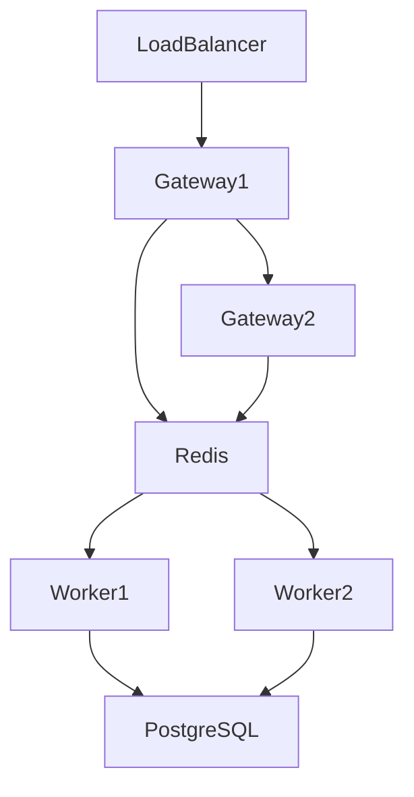

Future Improvements
- Redis Sentinel
- PostgreSQL replication
- Multiple Worker Nodes

### Configuration Management

Configuration Sources:
- Environmental Variables
- `.env` files (development)
- Docker Compose overrides
- Kubernetes ConfigMaps (future)
- Secret stores

Example categories:
- Database URLs
- API Keys
- LLM Model selection
- Retry policies
- Storage paths

### Secrets Management

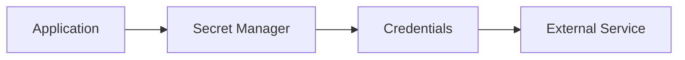

Principles:

- Never hardcode secrets
- Separate development and production credentials
- Rotate secrets periodically

### Logging Architecture

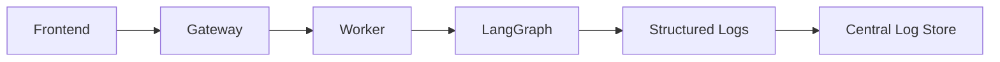

Each log entry includes
- Timestamp
- Trace ID
- Workflow ID
- Service name
- Log Level

### Montioring Architecture

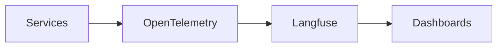

Metrics
- API Latency
- Workflow duration
- Queue depth
- LLM Latency
- Token usage
- Error Rates

### Health Checks

Every service exposes

| Endpoint  | Purpose         |
| --------- | --------------- |
| `/health` | Basic health    |
| `/ready`  | Readiness probe |
| `/live`   | Liveness probe  |

These endpoints enable orchestration platforms to monitor service health

### Deployment Environments

| Environment | Purpose                   |
| ----------- | ------------------------- |
| Local       | Development               |
| Development | Shared testing            |
| Staging     | Pre-production validation |
| Production  | Live workloads            |

Each environment may use different models, databases, and storage backends.

### Docker Compose Architecture

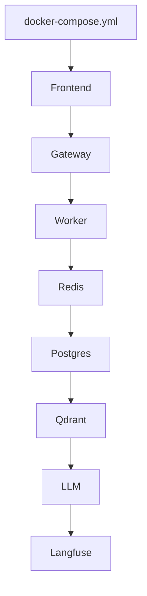

Docker compose serves as the primary deployment mechanism for local development and demonstrations.

### Future Kubernetes Architecture

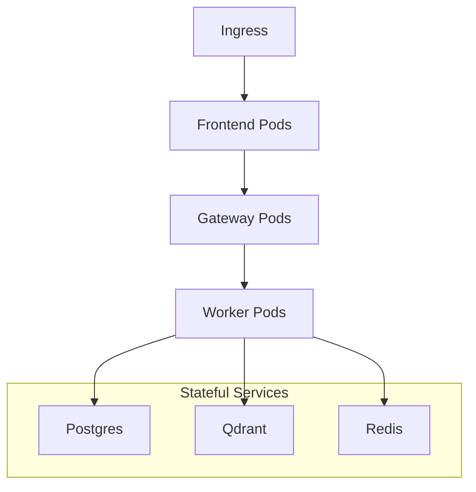

Future Enhancements
- Horizontal Pod Autoscaler
- Persistent Volumes
- Helm Charts
- Service Mesh (optional)

### Disaster Recovery

Recovery Strategy:
- Automated PostgreSQL backups
- Object storage snapshots
- Configuration backups
- Workflow checkpoint persistence
- Container image versioning

Recovery Objective:
- Resume interrupted workflows from checkpoints without reprocessing completed steps.

### Performance Considerations
| Component  | Optimization               |
| ---------- | -------------------------- |
| Gateway    | Async request handling     |
| Workers    | Parallel task execution    |
| Redis      | In-memory queue            |
| PostgreSQL | Indexed queries            |
| Qdrant     | Optimized vector indexing  |
| LLM        | Model caching and batching |

### Architecture Decision Records (ADR)

| ADR ID  | Decision                                   | Rationale                               |
| ------- | ------------------------------------------ | --------------------------------------- |
| ADR-025 | Docker-first deployment                    | Consistent local and cloud environments |
| ADR-026 | Celery + Redis for asynchronous processing | Mature, reliable task queue             |
| ADR-027 | Dedicated LLM service                      | Decouple inference from business logic  |
| ADR-028 | Object storage for invoice files           | Scalable and cloud-agnostic             |
| ADR-029 | Container-per-service architecture         | Independent scaling and fault isolation |
