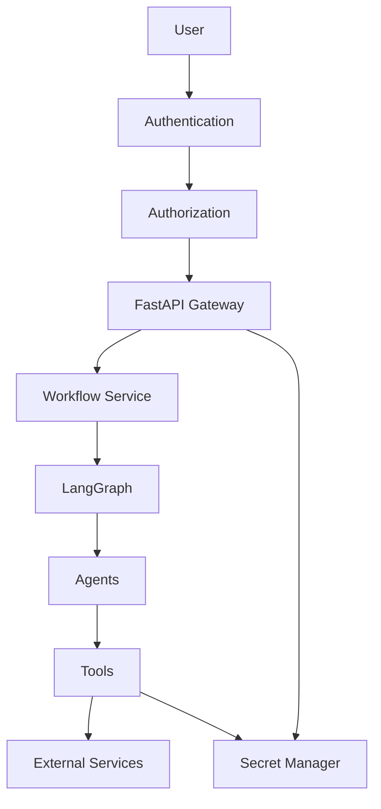
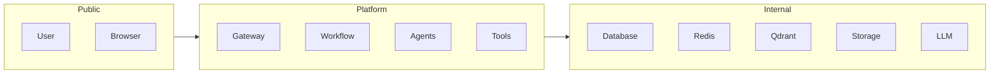
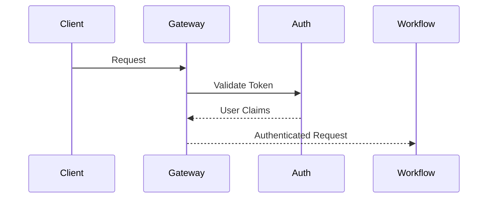
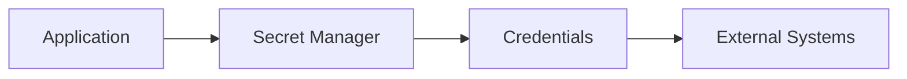
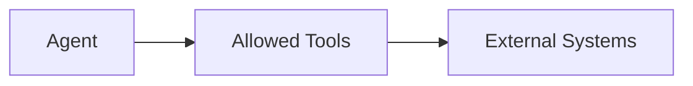
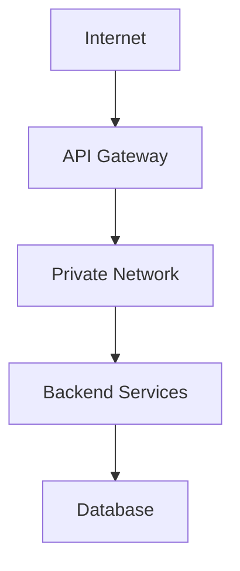
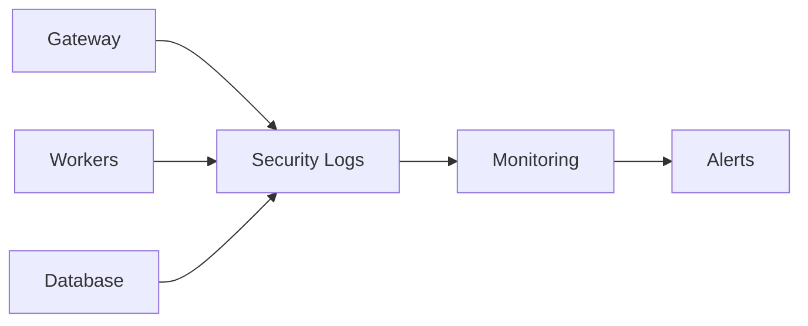
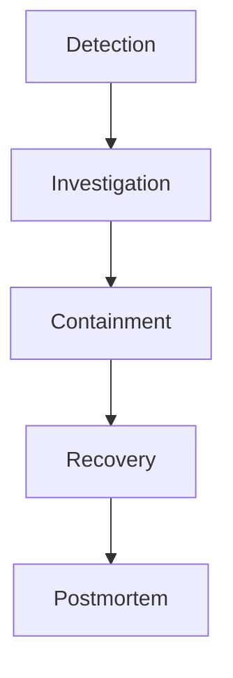

# OpenInvoiceAI

## Security Architecture

- Version: 1.0
- Author: Sharath S Hebbar
- Status: Draft

### Purpose

- This document defines the security architecture of the OpenInvoice-AI platform
- The objective is to ensure confidentiality, integrity, and availability of invoice data, workflow execution, AI Agents, and supporting infrastructure while mitigating risks specific to LLM-powered applications.

### Security Objectives
| Objective       | Description                             |
| --------------- | --------------------------------------- |
| Confidentiality | Protect invoices and business data      |
| Integrity       | Prevent unauthorized modification       |
| Availability    | Ensure reliable operation               |
| Authentication  | Verify user identity                    |
| Authorization   | Restrict access to resources            |
| Auditability    | Maintain a complete audit trail         |
| Compliance      | Support enterprise governance practices |

### Security Architecture

### Trust Boundaries

Everything crossing a trust boundary must be authenticated, validated, and logged.

### Authentication 

Supported mechanism
- JWT
- API Keys
- OAuth2 (future)

Authentication occurs at the API Gateway

### Authorization

Role based access control (RBAC)

| Role     | Permissions          |
| -------- | -------------------- |
| Admin    | Full access          |
| Operator | Manage workflows     |
| Reviewer | Human review actions |
| Viewer   | Read-only dashboards |

Future Enhancement
- Attribute Based Access Control (ABAC)

### Secrets Management

Secrets include:
- Database passwords
- API Keys
- LLM Credentials
- Storage Credentials

Secrets are never committed to source control.

### Secure File Upload

Validation Pipeline:

Accepted formats
- PDF
- PNG
- JPEG

Rejected
- Executables
- Scripts
- Unsupported archives

### Input validation
Every API request undergoes:
- Schema Validation
- Size limits
- Content validation
- Filename sanitization
- Request normalization

### LLM Security

Potential Threats
- Prompt injection
- Data leakage
- Hallucinated actions
- Prompt Manipulation

Mitigations
- Structred Prompts
- Tool Restrictions
- Output schema validation
- Confidence thresholds
- Human Review 

### Agent Security

Agents
- Cannot access secrets
- Cannot call arbitrary services
- Only invoke registered tools
- Operate with least privilege

### Tool Security

Each tool
- Validates input
- Sanitizes requests
- Handles credentials internally
- Emits audit logs
- Enforces timeouts

### Database Security

Measures include

- Parameterized queries
- Least-privilege accounts
- Encryption at rest (future)
- Encrypted backups
- Audit Logging

### Network Security

Only the Gateway is internet-facing

### Encryption

| Data       | Protection        |
| ---------- | ----------------- |
| In Transit | TLS               |
| At Rest    | Disk encryption   |
| Secrets    | Secret manager    |
| Backups    | Encrypted storage |

### Audit Logging

Every sensitive action records:
- User ID
- Workflow ID
- Timestamp
- Action
- Outcome
- Source IP (future)

### Threat Model

| Threat              | Mitigation                          |
| ------------------- | ----------------------------------- |
| Prompt Injection    | Prompt isolation, output validation |
| Malicious Upload    | File validation, scanning           |
| Credential Leakage  | Secret manager                      |
| Unauthorized Access | RBAC                                |
| Replay Attacks      | Token expiration                    |
| Denial of Service   | Rate limiting                       |
| SQL Injection       | Parameterized queries               |
| Data Tampering      | Audit logs                          |

### Security Monitoring

Alerts include:
- Authentication failures
- Excessive Retries
- Unusual upload rates
- Repeated workflow failures

### Incident Response

Standard response process

### Compliance Considerations

The design supports alignment with enterprise practices such as:
- Data retention policies
- Auditability
- Access control
- Secure software development lifecycle

Specific regulatory compliance (e.g., GDPR, HIPAA) would require additional implementation based on deployment context.

### Future Enhancements

| Feature                 | Purpose                             |
| ----------------------- | ----------------------------------- |
| MFA                     | Stronger authentication             |
| Vault Integration       | Centralized secret management       |
| WAF                     | Protect public APIs                 |
| DLP                     | Prevent sensitive data leakage      |
| Document Classification | Automatic sensitivity labeling      |
| Security Scanning       | Continuous vulnerability assessment |

### Architecture Decision Records (ADR)

| ADR ID  | Decision                     | Rationale                        |
| ------- | ---------------------------- | -------------------------------- |
| ADR-030 | Gateway-only authentication  | Centralized security enforcement |
| ADR-031 | Agents cannot access secrets | Least-privilege architecture     |
| ADR-032 | Tool-based external access   | Improved control and auditing    |
| ADR-033 | Structured LLM outputs       | Reduce prompt injection impact   |
| ADR-034 | Comprehensive audit logging  | Traceability and compliance      |

