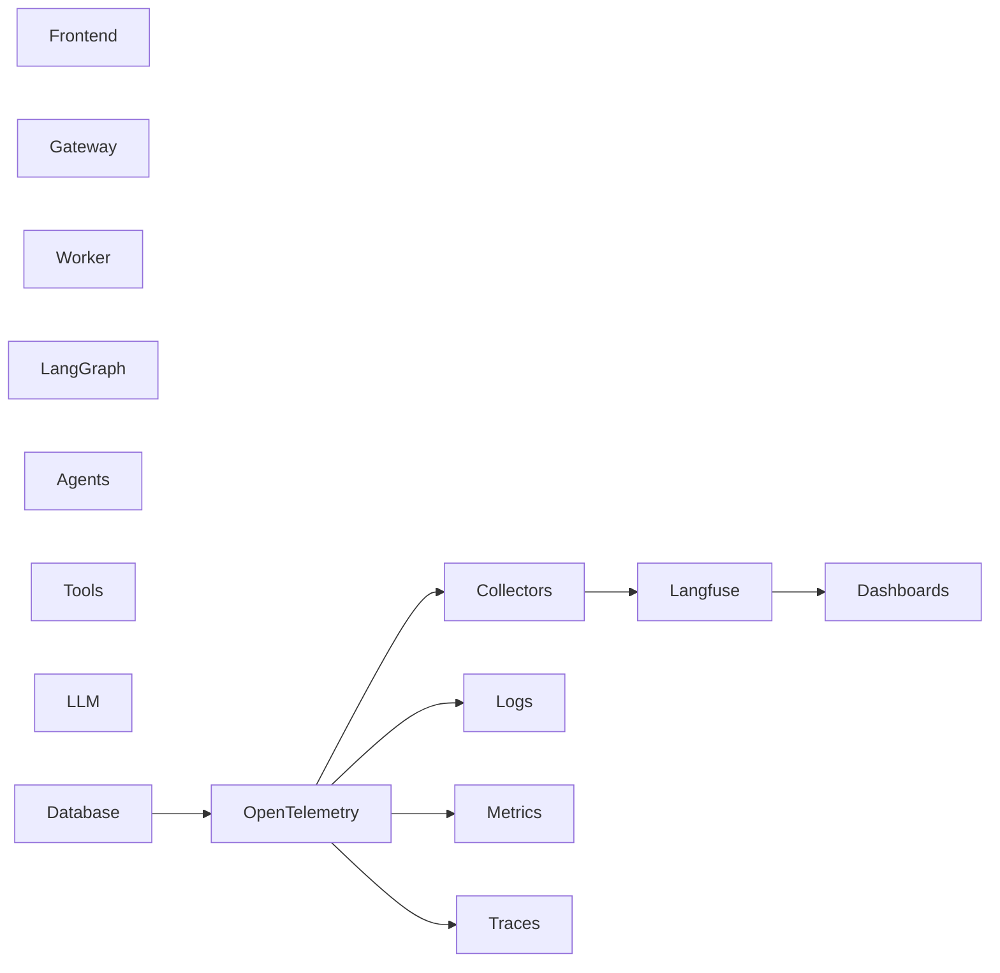
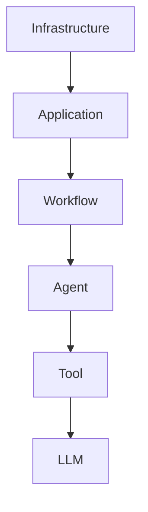
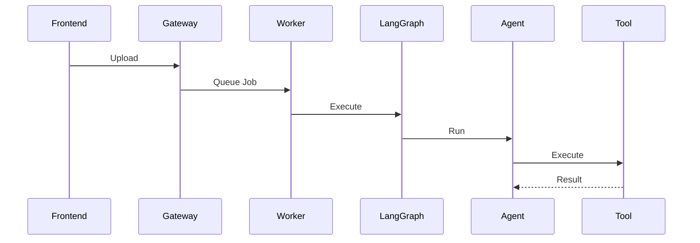
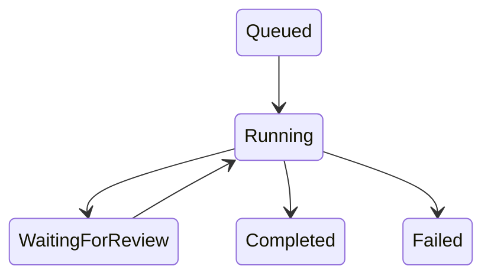
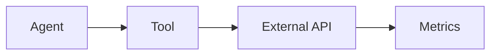
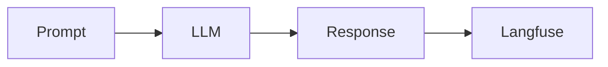
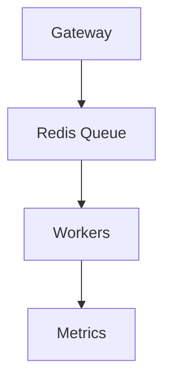
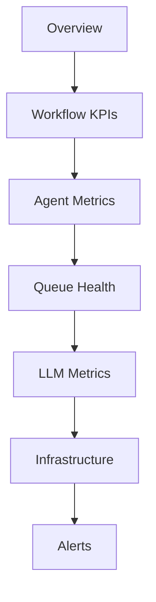
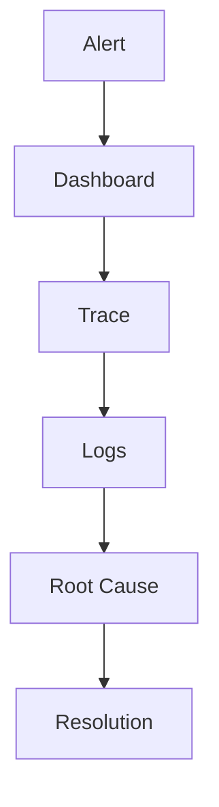
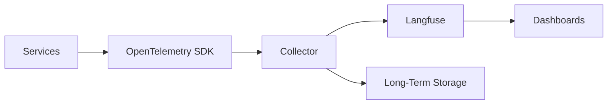

# OpenInvoiceAI

## Observability and Monitoring

- Version: 1.0
- Author: Sharath S Hebbar
- Status: Draft

### Purpose

- This document defines the observability architecture for the OpenInvoice-AI Platform
- The platform consits of distributed services, asynchronous workflows, AI Agents, external tools, and LLM Inference. Observability enables operators and developers to understand system behaviour, troubleshoot failures, monitor performance, and evaluate AI quality.
- The observability strategy is built on three pillars:
    - Logs: What happend?
    - Metrics: How is the system performing?
    - Traces: How did a request move through the system?

### Objectives

| Objective              | Description                                     |
| ---------------------- | ----------------------------------------------- |
| Traceability           | Follow an invoice through every processing step |
| Debuggability          | Diagnose workflow and agent failures            |
| Performance Monitoring | Measure latency and throughput                  |
| Cost Visibility        | Track LLM usage and inference costs             |
| Reliability            | Detect failures quickly                         |
| Auditability           | Maintain complete execution history             |

### Observability Architecture

### Observability Layers

### Logging Strategy

Every service produces structured JSON logs.

Required fields:

| Field       | Description                |
| ----------- | -------------------------- |
| Timestamp   | Event time                 |
| Service     | Source service             |
| Workflow ID | Workflow identifier        |
| Invoice ID  | Invoice identifier         |
| Trace ID    | Distributed tracing        |
| Span ID     | Current operation          |
| Log Level   | INFO/WARN/ERROR            |
| Message     | Human-readable description |

### Distributed Tracing

Each invoice receives a unique trace.

Every step shares the same Trace ID.

### Workflow Monitoring

Track:
- Workflow status
- Current node
- Duration
- Retry Count
- Human review time
- Completion rate

### Agent Monitoring

Each agent emits

| Metric           | Description           |
| ---------------- | --------------------- |
| Execution count  | Number of invocations |
| Latency          | Execution duration    |
| Success rate     | Successful executions |
| Failure rate     | Failed executions     |
| Retry count      | Retry attempts        |
| Tokens consumed  | LLM usage             |
| Tool invocations | Number of tool calls  |

### Tool Monitoring

Monitor:
- Invocation count
- Latency
- Success Rate
- Failure Rate
- Timeout Count
- External Dependency errors

### LLM Observability

Capture
- Prompt Version
- Model Name
- Temperature
- Tokens in
- Tokens out
- Latency
- Estimated cost
- Completion status

### Queue Monitoring

Metrics
- Queue depth
- Waiting Jobs
- Active Workers
- Processing Rate
- Failed Jobs
- Retry Queue size

### Database Monitoring

Track:
- Query Latency
- Connection Pool Usage
- Transaction Rate
- Failed Queries
- Storage Growth

### Infrastructure Monitoring

Monitor:
- CPU
- Memory
- Disk
- Network
- GPU Utilization (LLM Server)
- Container Health

### Dashboard Design

Operational dashboars should include:

### Alerting Strategy

Critical Alerts:

| Alert                 | Trigger                   |
| --------------------- | ------------------------- |
| Workflow failure rate | Above threshold           |
| Queue backlog         | Exceeds limit             |
| LLM unavailable       | Health check failure      |
| Database unavailable  | Connection failure        |
| Agent timeout         | Execution exceeds SLA     |
| High token usage      | Budget threshold exceeded |

### Service Level Indicators (SLIs)

| SLI                   | Description                     |
| --------------------- | ------------------------------- |
| Workflow Success Rate | % completed successfully        |
| API Availability      | Successful requests             |
| Queue Processing Time | Time in queue                   |
| OCR Success Rate      | Successful extraction           |
| Agent Success Rate    | Successful executions           |
| Human Review Rate     | % requiring manual intervention |

### Service Level Objectives (SLOs)

Example Targets

| Metric               | Target      |
| -------------------- | ----------- |
| API Availability     | 99.9%       |
| Workflow Completion  | 95%         |
| OCR Accuracy         | >98%        |
| Agent Failure Rate   | <2%         |
| Queue Wait Time      | <10 seconds |
| P95 Workflow Latency | <2 minutes  |

These are illustrative goals and should be tuned based on workload and deployment

### Cost Monitoring

Track:
- Tokens per workflow
- Cost per invoice
- Daily LLM Spend
- Model utilization
- Average Inference Latency

### Incident Investigation

The goal is to enable root-cause analysis from a single workflow execution

### Telmetry Data Flow

### Future Enhancements

| Feature               | Purpose                       |
| --------------------- | ----------------------------- |
| Grafana               | Unified dashboards            |
| Prometheus            | Metrics storage               |
| Loki                  | Centralized logging           |
| Jaeger                | Distributed tracing           |
| Auto-remediation      | Automated recovery actions    |
| AI-assisted debugging | Intelligent incident analysis |

### Architecture Decision Records (ADR)

| ADR ID  | Decision                             | Rationale                       |
| ------- | ------------------------------------ | ------------------------------- |
| ADR-035 | OpenTelemetry for telemetry          | Vendor-neutral instrumentation  |
| ADR-036 | Langfuse for LLM observability       | Native AI workflow visibility   |
| ADR-037 | Structured JSON logging              | Easier aggregation and search   |
| ADR-038 | Distributed tracing across workflows | End-to-end debugging            |
| ADR-039 | SLI/SLO-driven monitoring            | Measure operational reliability |

