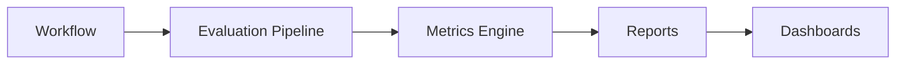
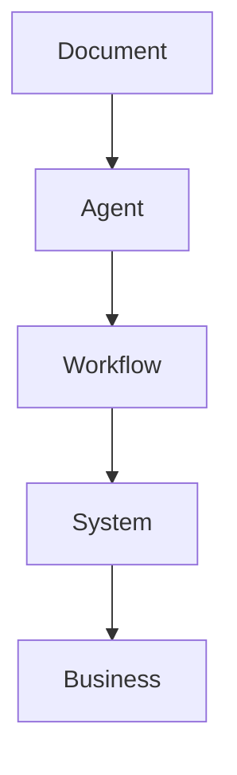
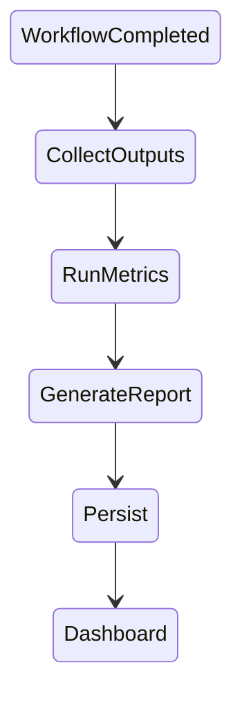
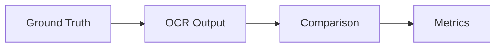
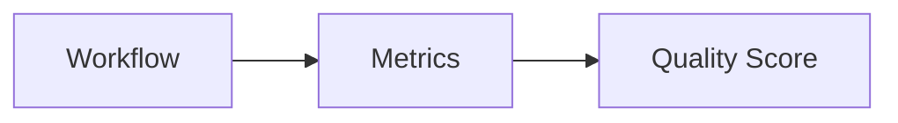
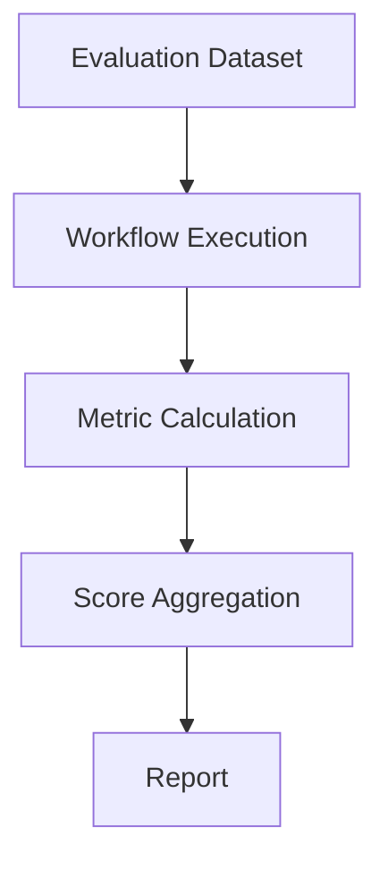
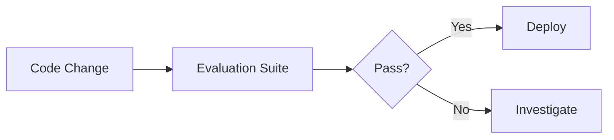
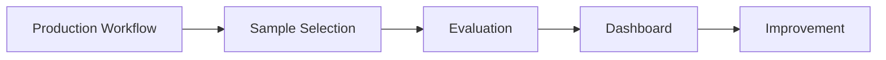

# OpenInvoiceAI

## Evaluation Strategy

- Version: 1.0
- Author: Sharath S Hebbar
- Status: Draft

### Purpose

- This document defines the evaluation framework for the OpenInvoice-AI Platform.
- Unlike deterministic software, AI-powered systems require continuous evaluation of model quality, workflow correctness, tool usage, latency, and cost.

- The evaluation framework enables:
    - Offline benchmarking
    - Continuous regression testing
    - Production monitoring
    - Model comparison
    - Prompt Comparison
    - Workflow Optimization

### Evaluation Architecture

### Evaluation Layers

Each layer has independent evaluation criteria.

### Evaluation Lifecycle

### EvaluatioN Categories

| Category         | Purpose                     |
| ---------------- | --------------------------- |
| OCR Quality      | Measure extraction accuracy |
| Agent Quality    | Measure reasoning quality   |
| Tool Quality     | Validate tool usage         |
| Workflow Quality | Evaluate orchestration      |
| LLM Quality      | Prompt/model effectiveness  |
| Operational      | Latency & cost              |
| Business         | Invoice processing outcomes |

### OCR Evaluation

Metrics Include:
- Character Error Rate (CER)
- Word Error Rate (WER)
- Field Extraction Accuracy
- Table Extraction Accuracy
- Confidence Distribution

### Agent Evaluation

Each Agent is evaluated independently.

Metrics:
| Metric         | Description             |
| -------------- | ----------------------- |
| Correctness    | Expected decision       |
| Completeness   | Required fields handled |
| Consistency    | Stable across runs      |
| Tool Selection | Correct tool chosen     |
| Hallucination  | Unsupported outputs     |
| Confidence     | Decision confidence     |

### Workflow Evaluation

Evaluate:
- Successful completion
- Retry Count
- Human Intervention rate
- Recovery from failures
- End-to-end correctness

### LLM Evaluation

Capture:
- Prompt Version
- Model Version
- Latency
- Tokens in/out
- Estimated cost
- Response validity

Compare multiple models (e.g., Gemma, Qwen, Llama) against the same evaluation dataset.

### Tool Evaluation

Assess:
- Correct Tool Selection
- Invocation Success
- Response Latency
- Error Handling
- External Dependency Reliability

### Business Evaluation

Track Business-oriented metrics:

| Metric                           | Description                       |
| -------------------------------- | --------------------------------- |
| Straight-through processing rate | % processed without manual review |
| Human review rate                | % requiring intervention          |
| Approval accuracy                | Correct approval decisions        |
| False rejection rate             | Incorrect rejections              |
| Processing time                  | End-to-end duration               |

### Dataset Strategy

Evaluation datasets should include:
- Clean Invoices
- Noisy Scans
- Rotated Documents
- Multi-page invoices
- Different vendors
- Multiple currencies
- Handwritten annotations (future)

Version all datasets to ensure reproducibility

### Evaluation Pipeline

### Metrics Dashboard

Display:
- OCR Accuracy
- Agent Correctness
- Workflow success rate
- Average Latency
- Cost per invoice
- Hallucination Rate
- Human Review Percentage

### Regression Testing

Every change to:
- Prompt
- Model
- Tool
- Agent Logic
- Workflow

must trigger the evaluation suite

### Benchmarking

Compare:
- Models
- Prompt Version
- OCR Engines
- Retrieval Strategies
- Workflow configurations

User identical datasets to ensure fair comparisons

### Evaluation Tools

| Tool           | Purpose                   |
| -------------- | ------------------------- |
| DeepEval       | LLM evaluation            |
| RAGAS          | Retrieval evaluation      |
| Promptfoo      | Prompt regression testing |
| Custom Metrics | Business-specific scoring |

### Scorecard

Example Composite Score:

| Dimension         | Weight |
| ----------------- | ------ |
| OCR Accuracy      | 25%    |
| Agent Correctness | 25%    |
| Workflow Success  | 20%    |
| Latency           | 10%    |
| Cost              | 10%    |
| Human Review Rate | 10%    |

The weighting should reflect business priorities and may evolve over time.

### Reporting 

Evaluation reports include:
- Overall Score
- Metric breakdown
- Failed cases
- Trend Analysis
- Comparison with previous versions
- Recommended improvements

### Continuous Evaluation

Periodically Sample production workflows (with appropriate privacy controls) to detect quality drift.

### Failure Analysis

When evaluation fails:

1. Identify failing component
2. Determine whether the issue is OCR, Agent Reasoning, Tool Behaviour, Workflow logic, or model quality.
3. Reproduce with the evaluation dataset.
4. Apply fixes and rerun the suite.
5. Compare results with the baseline.

### Future Enhancements

| Feature                       | Purpose                                  |
| ----------------------------- | ---------------------------------------- |
| Human-in-the-loop scoring     | Expert review of difficult cases         |
| Automated prompt optimization | Improve prompts based on results         |
| Drift detection               | Monitor model performance over time      |
| A/B testing                   | Compare prompts or models in production  |
| Active learning               | Prioritize difficult invoices for review |

### Architecture Decision Records (ADR)

| ADR ID  | Decision                                | Rationale                                      |
| ------- | --------------------------------------- | ---------------------------------------------- |
| ADR-040 | Multi-layer evaluation strategy         | Different components require different metrics |
| ADR-041 | Continuous regression testing           | Prevent quality regressions                    |
| ADR-042 | Dataset versioning                      | Reproducible benchmarks                        |
| ADR-043 | Composite scorecards                    | Balance quality, latency, and cost             |
| ADR-044 | Separate business and technical metrics | Align engineering work with business outcomes  |

