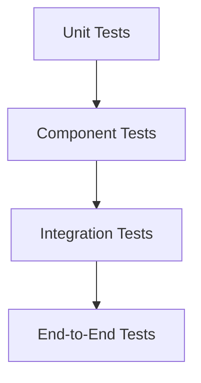
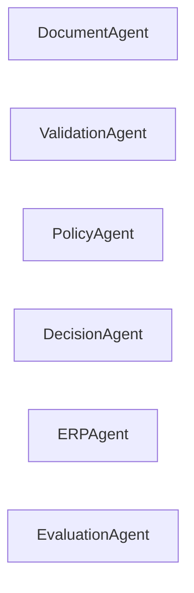
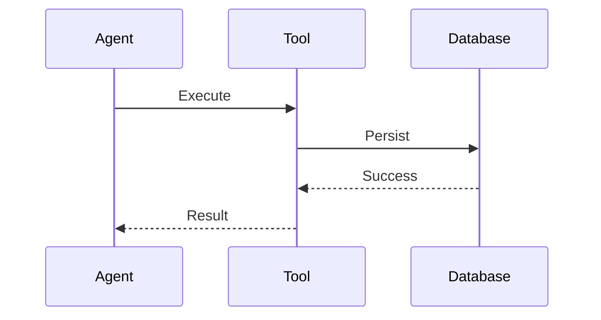
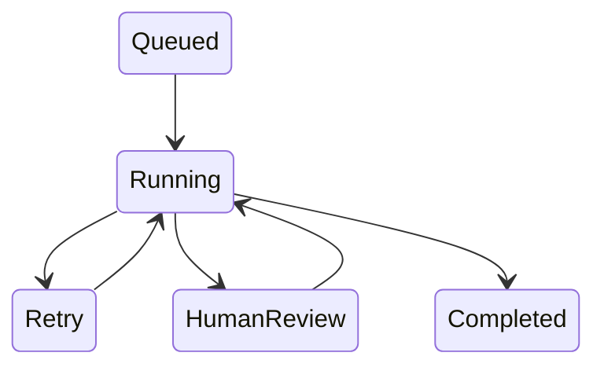
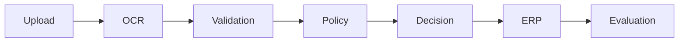
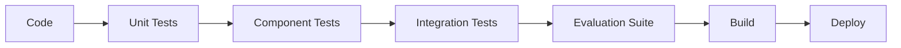

# OpenInvoiceAI

## Testing Strategy

- Version: 1.0
- Author: Sharath S Hebbar
- Status: Draft

### Purpose

- This document defines the testing strategy for the OpenInvoice-AI Platform.
- Because the platform consists of multiple services, asynchronous workflows, AI Agents, LLMs, external tools, and human review, testing extends beyond traditional unit testing.
- The strategy ensures:
    - Functional correctness
    - Workflow reliability
    - AI quality
    - Infrastructure stability
    - Regression prevention

### Testing Pyramind

### Testing Layers

| Layer          | Scope                             |
| -------------- | --------------------------------- |
| Unit           | Individual functions/classes      |
| Component      | Agents, Tools, Services           |
| Integration    | Multiple components               |
| Workflow       | LangGraph execution               |
| API            | REST endpoints                    |
| UI             | Frontend interactions             |
| End-to-End     | Complete invoice processing       |
| Non-functional | Performance, resilience, security |

### Unit Testing

Focus:
- Utility functions
- Parsers
- Validators
- Data transformations
- Configuration loaders

Characteristics
- Fast execution
- No external dependencies
- Deterministic

### Component Testing

Component tested independently:

Each component is tested with mocked dependencies.

### Tool Testing

Every tool should verify:
- Successful execution
- Invalid inputs
- Timeout handling
- Error propagation
- Retry behaviour

Example tools:
- OCR Tool
- Database Tool
- Vector Tool
- ERP Tool
- LLM Tool

### Integration Tool

Verify interactions between components.

Examples:

- Agent <-> Tool
- Workflow <-> Database
- Workflow <-> Queue
- API <-> Workflow
- Frontend <-> API

### Workflow Testing

Validate complete LangGraph workflows
Scenarios:
- Happy Path
- OCR Failure
- Validation Failure
- Policy violation
- Human Review
- Retry
- Resume
- Cancellation

### API Testing

Verify
- Request Validation
- Authentication
- Authorization
- Error Responses
- Pagination
- Rate Limiting

Endpoints
- Invoice
- Workflow
- Evaluation
- Health
- Configuration

### Frontend Testing

Test:
- Upload flow
- Dashboard rendering
- Human Review
- Workflow Tracking
- Error messages

Automation can be added using browser testing tools in future iterations.

### End-to-End Testing

Complete Workflow

Assertions:
- Workflow completes successfully
- State transitions are correct
- Database updated
- Audit logs generated
- Evaluation recorded

### AI Testing

Traditional assertions are insufficient.

Validate:
- Structured Outputs
- JSON Schema compliance
- Tool Selection
- Hallucination Rate
- Prompt stability
- Reasoning Quality

These tests complement the broader Evaluation Strategy.

### Performance Testing

Measure:
- API Latency
- Workflow duration
- OCR Throughput
- Agent Latency
- Queue processing time
- Concurrent workflow execution

### Load Testing

| Scenario             | Goal                 |
| -------------------- | -------------------- |
| Burst uploads        | Queue scalability    |
| Concurrent workflows | Worker scalability   |
| Multiple users       | API performance      |
| High OCR volume      | Resource utilization |

### Resilience Testing

Test failures such as:
- Redis unavailable
- PostgreSQL unavailable
- LLM Unavailable
- OCR Timeout
- Worker Crash
- Network interruption

Expected behaviour:
- Retry where appropriate
- Resume from checkpoints
- Preserve workflow state

### Security Testing

Verify:
- Authentication
- Authorization
- File upload validation
- Input Sanitization
- Rate limiting
- Secret isolation

### Test Data Strategy

Maintain version-controlled datasets including:

- Valid Invoices
- Corrupted PDFs
- Multi-page invoices
- Low-quality scans
- Duplicate invoices
- Invalid formats

Separate synthetic and real-world anonymized data where applicable.

### CI/CD Testing Pipeline

Deployment proceeds only if required quality gates pass.

### Test Environment Matrix

| Environment | Purpose                     |
| ----------- | --------------------------- |
| Local       | Developer testing           |
| CI          | Automated validation        |
| Staging     | Pre-production verification |
| Production  | Smoke tests and monitoring  |

### Test Coverage Goals

Illustrative targets:

| Area           | Goal |
| -------------- | ---- |
| Utility Code   | >90% |
| Agents         | >85% |
| Tools          | >85% |
| API            | >90% |
| Workflow Logic | >90% |

Coverage percentages are guides, meaningful scenario coverage is more important than raw numbers.

### Failure Reporting

Every failed test records:
- Test Name
- Component
- Workflow ID (if applicable)
- Input dataset
- Expected result
- Actual result
- Logs
- Trace ID

### Future Enhancement

| Feature                         | Purpose                      |
| ------------------------------- | ---------------------------- |
| Chaos engineering               | Validate fault tolerance     |
| Property-based testing          | Broader input exploration    |
| Contract testing                | API compatibility            |
| Visual regression testing       | Frontend consistency         |
| Continuous synthetic monitoring | Production health validation |

### Architecture Decision Records (ADR)

| ADR ID  | Decision                                      | Rationale                             |
| ------- | --------------------------------------------- | ------------------------------------- |
| ADR-045 | Layered testing strategy                      | Match system architecture             |
| ADR-046 | Workflow replay testing                       | Validate long-running processes       |
| ADR-047 | AI evaluation complements traditional testing | LLMs require probabilistic evaluation |
| ADR-048 | CI quality gates                              | Prevent regressions                   |
| ADR-049 | Versioned test datasets                       | Reproducible testing                  |
