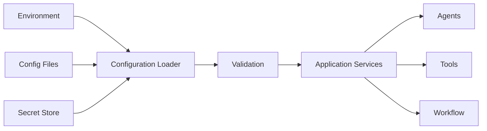
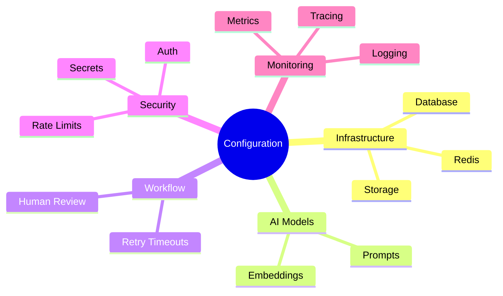
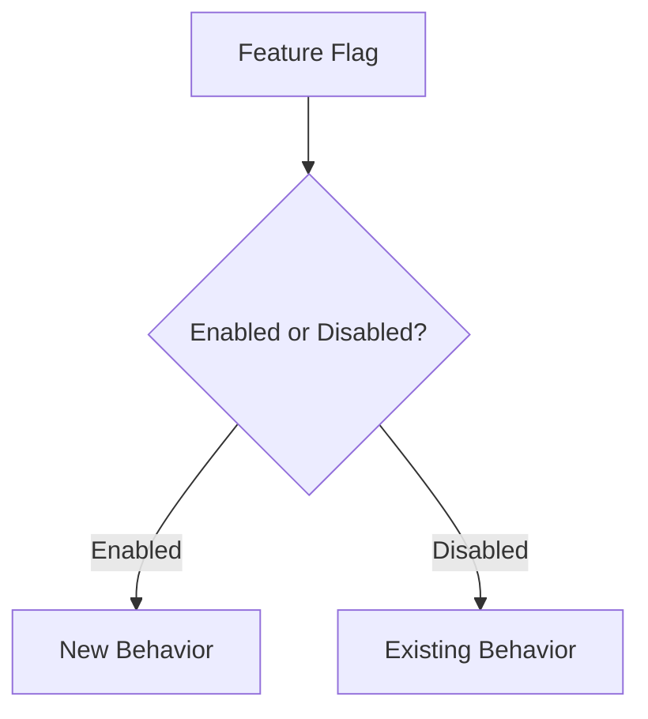
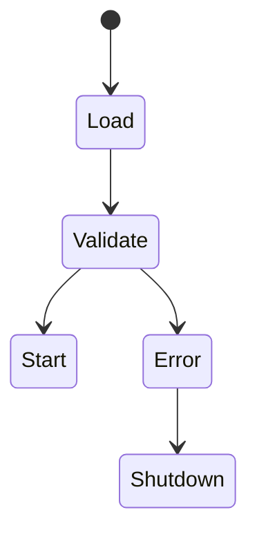

# OpenInvoiceAI

## Runtime Configuration

- Version: 1.0
- Author: Sharath S Hebbar
- Status: Draft

### Purpose

- This document defines how runtime configuration is managed throughout the OpenInvoice-AI Platform
- The objective is to separate configuration from application code, enabling the platform to adapt to different environments, AI Models, infrastructure, and business requirements without requiring code changes.
- Configuration covers infrastructure, workflow behaviour, AI models, prompts, feature flags, security, and operational settings.

### Design Principles

| Principle            | Description                                    |
| -------------------- | ---------------------------------------------- |
| Externalized         | Configuration lives outside source code        |
| Environment-specific | Each environment has independent configuration |
| Versioned            | Configuration changes are tracked              |
| Secure               | Secrets are isolated from configuration        |
| Validated            | Configuration is schema validated at startup   |
| Observable           | Active configuration is visible for debugging  |

### Configuration Architecture

### Configuration Sources

Priority Order:

| Priority | Source                     |
| -------- | -------------------------- |
| 1        | Environment Variables      |
| 2        | Secret Manager             |
| 3        | `.env` Files (Development) |
| 4        | YAML Configuration         |
| 5        | Default Values             |

This deterministic precendence ensures predictable runtime behaviour.

### Configuration Domains

### Environment Configuration

Supported environments
- Local
- Development
- Staging
- Production

Each environment can define:
- Database connections
- Queue configurations
- Storage backends
- LLM Providers
- Monitoring endpoints

### AI Model Configuration

Runtime configuration includes:

| Setting     | Example    |
| ----------- | ---------- |
| Provider    | Ollama     |
| Model       | Qwen 3     |
| Temperature | 0.0        |
| Max Tokens  | 2048       |
| Timeout     | 60 seconds |
| Retry Limit | 3          |

Future Enhancement
- Dynamic model routing by task complexity.

### Prompt Configuration

Prompts are treated as versioned configuration rather than hardcoded strings

Each prompt includes:
- Prompt ID
- Version
- Target Agent
- Description
- Change History

### Workflow Configuration

Examples:
- Maximum Retries
- Retry Backoff
- Checkpoint frequency
- Human review threshold
- Maximum workflow duration

These settings allow operational tuning without modifying workflow code.

### Agent Configuration

Each agent exposes configurable parameters such as
- Enabled / disabled status
- Assigned model
- Timeout
- Retry Policy
- Confidence Threshold

### Tool Configuration

Examples:
- OCR Engine Selection
- Database connection pool size
- Vector search parameters
- ERP Endpoint
- API timeouts

### Feature Flags

Feature flags enable gradual rollout of capabilities.

Examples
| Feature                | Purpose             |
| ---------------------- | ------------------- |
| New OCR Engine         | Controlled rollout  |
| Experimental Prompt    | A/B testing         |
| New Decision Logic     | Canary deployment   |
| Multi-language Support | Progressive release |

### Configuration Validation

At startup:

- Load Configuration
- Validate schema
- Verify required secrets
- Check connectivity where appropriate.
- Fail fast if critical configuration is invalid.

### Configuration Reload

Some configuration may be reloaded dynamically:

- Feature flags
- Prompt Versions
- Thresholds

Other settings (e.g., database connections) require service restart.

### Secrets Separation

Configuration and secrets are managed independently.

This prevents accidental exposure of credentials.

### Configuration Audit

Every configuration change records:
- Timestamp
- User (if applicable)
- Previous value
- New value
- Reason for change

This supports operational traceability.

### Example Configuration Categories

| Category       | Examples                   |
| -------------- | -------------------------- |
| Infrastructure | Database URLs, Redis host  |
| AI             | Model names, temperature   |
| Workflow       | Retry limits, checkpoints  |
| Security       | Rate limits, auth settings |
| Monitoring     | Log level, tracing         |
| UI             | Dashboard refresh interval |

### Failure Handling

If configuration is invalid

The application should fail fast rather than operate with undefined behaviour.

### Future Enhancements

| Feature                       | Purpose                        |
| ----------------------------- | ------------------------------ |
| Central configuration service | Shared runtime management      |
| Dynamic model routing         | Optimize cost and latency      |
| Prompt registry UI            | Manage prompt versions         |
| Configuration drift detection | Ensure environment consistency |
| Policy-as-code                | Versioned operational rules    |

### Architecture Decision Records (ADR)

| ADR ID  | Decision                            | Rationale                           |
| ------- | ----------------------------------- | ----------------------------------- |
| ADR-050 | Externalize configuration           | Separate code from runtime behavior |
| ADR-051 | Version prompts                     | Improve reproducibility             |
| ADR-052 | Feature flags for AI capabilities   | Safer experimentation               |
| ADR-053 | Schema validation at startup        | Prevent invalid deployments         |
| ADR-054 | Separate secrets from configuration | Strengthen security                 |

