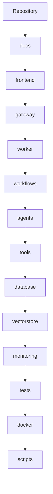
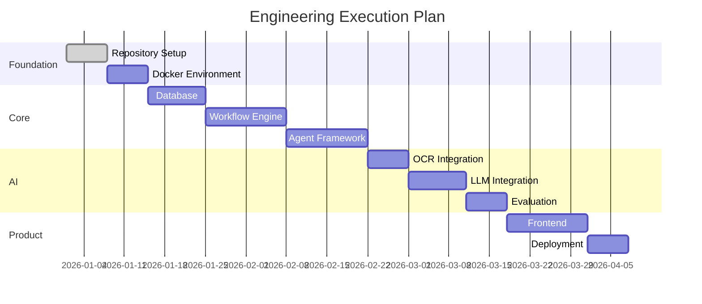
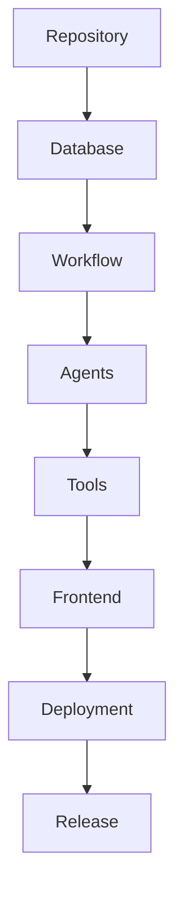
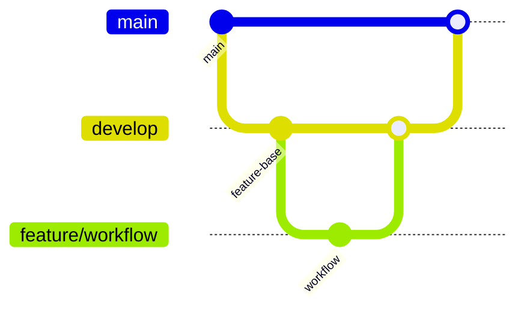
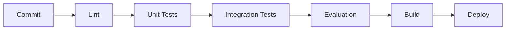
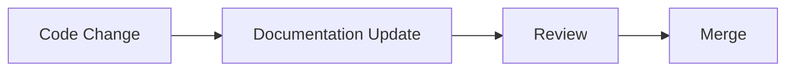
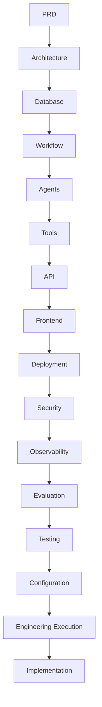

# OpenInvoiceAI

## Engineering Execution Plan

- Version: 1.0
- Author: Sharath S Hebbar
- Status: Draft


### Purpose

- This document defines the engineering execution strategy for implementing the OpenInvoice-AI Platform.
- It translates the architectural design into an actionable implementation plan covering repository organization, development workflow, coding standards, milestones, release planning, and future evolution.
- The objective is to ensure that development proceeds in a structure, predictable, and maintainable manner.

### Engineering Prinicples

| Principle                     | Description                                  |
| ----------------------------- | -------------------------------------------- |
| Incremental Delivery          | Deliver working software in small milestones |
| Architecture First            | Implementation follows approved design       |
| Test-Driven                   | Validate functionality continuously          |
| Observability by Default      | Instrument every major component             |
| Configuration over Hardcoding | Externalize runtime behavior                 |
| Documentation as Code         | Keep documentation version-controlled        |


### Repository Structure



Example structure

```
openinvoice-ai/
│
├── docs/
├── frontend/
├── gateway/
├── worker/
├── workflows/
├── agents/
├── tools/
├── database/
├── vectorstore/
├── monitoring/
├── tests/
├── docker/
├── scripts/
├── pyproject.toml
└── README.md
```

### Development Phases




The dates are illustrative; actual scheduling should reflect team size and priorities.


### Milestones

| Milestone | Deliverable                            |
| --------- | -------------------------------------- |
| M1        | Repository and development environment |
| M2        | Database and persistence layer         |
| M3        | Workflow orchestration                 |
| M4        | Agent implementation                   |
| M5        | Tool integrations                      |
| M6        | OCR and LLM integration                |
| M7        | Evaluation and observability           |
| M8        | Frontend                               |
| M9        | Deployment                             |
| M10       | Production-ready MVP                   |


### Sprint Breakdown

| Sprint    | Goal           |
| --------- | -------------- |
| Sprint 1  | Foundation     |
| Sprint 2  | Database       |
| Sprint 3  | Workflow       |
| Sprint 4  | Agents         |
| Sprint 5  | Tools          |
| Sprint 6  | AI Integration |
| Sprint 7  | Frontend       |
| Sprint 8  | Deployment     |
| Sprint 9  | Stabilization  |
| Sprint 10 | Release        |


### Dependency Graph



This ensures that implementation follows the architectural dependencies.

### Git Workflow

Recommended branching strategy:



Branches
- `main`
- `develop`
- `feature/*`
- `bugfix/*`
- `release/*`


### Coding Standards

Guidelines:
- Type hints for all public interfaces
- Async I/O where appropriate
- Pydantic models for contracts
- Ruff for linting
- Black for formatting
- MyPy for static typing.
- Docstrings for public APIs


### Definition of Done

A feature is considered complete when:
- Functional requirements are met.
- Unit test pass.
- Integration test pass
- Documentation is updated
- Observability is added
- Security considerations addressed
- Code reviewed
- CI Pipeline succeeds.


### CI / CD Pipeline



Every merge to the main branch should pass the pipeline

### Release Strategy

| Stage             | Purpose                  |
| ----------------- | ------------------------ |
| Alpha             | Internal validation      |
| Beta              | Limited external testing |
| Release Candidate | Final verification       |
| Stable            | Public release           |

Semantic versioning is recommended.

### Risk Management

| Risk            | Mitigation                   |
| --------------- | ---------------------------- |
| OCR quality     | Evaluation datasets          |
| LLM drift       | Prompt versioning            |
| Queue backlog   | Worker scaling               |
| Tool failures   | Retry policies               |
| Cost escalation | Model routing and monitoring |


### Documentation Strategy

Documentation evolves with the codebase



Documentation changes should accompany significant architectural or behavioural changes


### Knowledge Transfer

New contributors should follow
- Read the Product requirements
- Review the system architecture
- Understand the workflow design
- Study the agent and tool contracts
- Set up the development environment
- Run the test suite
- Implement assigned features

### Success Criteria

The implementation is considered successful when:
- All major workflows execute correctly
- Human review operates as expected
- Evaluation metrics are collected
- Deployment is reproducible
- Documentation remains synchronized
- Core non-functional requirements are satisfied


### Future Roadmap

Potential Future initiatives

| Initiative                | Description                       |
| ------------------------- | --------------------------------- |
| Multi-tenant support      | SaaS deployment                   |
| Multi-language invoices   | Expanded OCR capabilities         |
| Additional ERP connectors | SAP, Oracle, Dynamics             |
| Multi-agent collaboration | Specialized domain agents         |
| Model routing             | Dynamic LLM selection             |
| Advanced analytics        | Business insights and forecasting |


### Architecture Decision Records (ADR)

| ADR ID  | Decision                           | Rationale                              |
| ------- | ---------------------------------- | -------------------------------------- |
| ADR-055 | Architecture before implementation | Reduce rework                          |
| ADR-056 | Incremental milestone delivery     | Lower implementation risk              |
| ADR-057 | Documentation-driven development   | Preserve architectural intent          |
| ADR-058 | CI/CD quality gates                | Maintain code quality                  |
| ADR-059 | Modular repository structure       | Enable scalability and maintainability |


### Design Package Summary




### Conclusion

- The OpenInvoice-AI design package now defines a complete blueprint for building operating and evolving a production-inspired agentic invoice processing platform. It captures architectural decisions, system contracts, operational practices, and engineering processess in a structured manner, enabling implementation to proceed with a shared understanding of the system's goals and design

